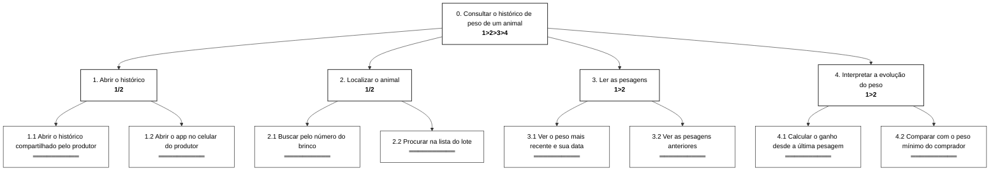
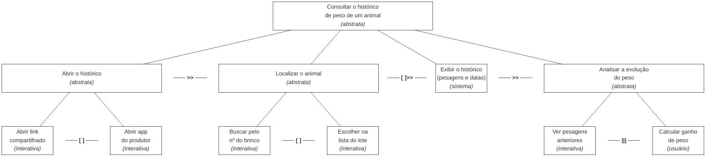
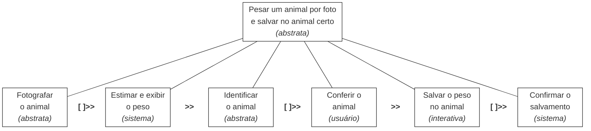
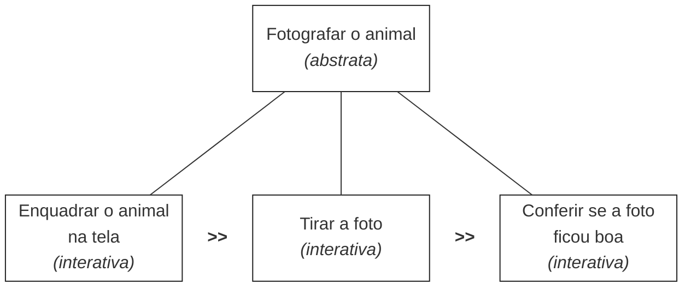
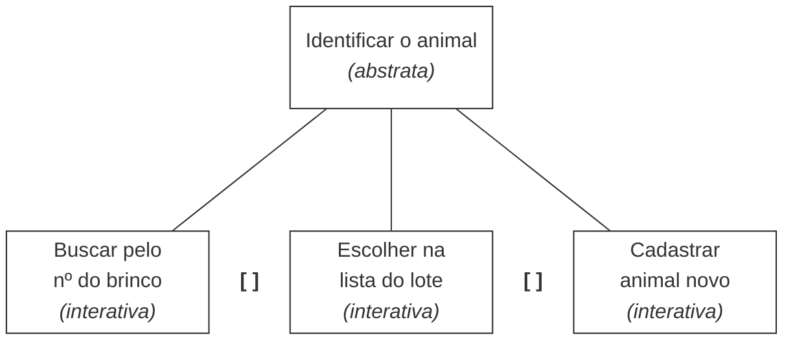

```mermaid
flowchart TD
    T0["0. Pesar um animal por foto e salvar o peso no animal certo<br><b>1>2>3>4>5</b>"]

    T1["1. Fotografar o animal<br><b>1>2>3</b>"]
    T2["2. Ver o peso estimado<br><b>1>2</b>"]
    T3["3. Identificar o animal<br><b>1/2/3</b>"]
    T4["4. Conferir se é o animal certo<br><b>1>2</b>"]
    T5["5. Salvar o peso no animal<br><b>1>2</b>"]

    T11["1.1 Enquadrar o animal inteiro na tela<br>══════════"]
    T12["1.2 Tirar a foto<br>══════════"]
    T13["1.3 Conferir se a foto ficou boa<br>══════════"]
    T21["2.1 Aguardar o peso aparecer<br>══════════"]
    T22["2.2 Ler o peso estimado<br>══════════"]

    T31["3.1 Identificar pelo brinco<br><b>1>2>3</b>"]
    T32["3.2 Escolher na lista do lote<br><b>1>2>3</b>"]
    T33["3.3 Cadastrar animal novo<br>══════════"]
    T311["3.1.1 Ler o brinco no animal<br>══════════"]
    T312["3.1.2 Digitar o número do brinco<br>══════════"]
    T313["3.1.3 Tocar no animal encontrado<br>══════════"]
    T321["3.2.1 Rolar a lista de animais<br>══════════"]
    T322["3.2.2 Reconhecer o animal pela foto ou descrição<br>══════════"]
    T323["3.2.3 Tocar no animal<br>══════════"]

    T41["4.1 Comparar o animal da tela com o animal à frente<br>══════════"]
    T42["4.2 Corrigir o animal escolhido<br>══════════"]
    T51["5.1 Tocar em salvar<br>══════════"]
    T52["5.2 Verificar se o app confirmou que salvou<br>══════════"]

    T0 --> T1 & T2 & T3 & T4 & T5
    T1 --> T11 & T12 & T13
    T2 --> T21 & T22
    T3 --> T31 & T32 & T33
    T31 --> T311 & T312 & T313
    T32 --> T321 & T322 & T323
    T4 --> T41 & T42
    T5 --> T51 & T52

    classDef obj fill:#fff,stroke:#222,stroke-width:1.5px,color:#000
    classDef op fill:#fff,stroke:#222,stroke-width:1px,color:#000
    class T0,T1,T2,T3,T4,T5,T31,T32 obj
    class T11,T12,T13,T21,T22,T33,T311,T312,T313,T321,T322,T323,T41,T42,T51,T52 op
```

# Entrega 5 — Análise de tarefas: HTA, GOMS e CTT

**Data:** {{13/10/2026}}  
**Status:** 🟨 em andamento 
**Responsabilidade:** cada integrante modela pelo menos 1 HTA, 1 GOMS e 1 CTT. As três técnicas podem abordar a mesma funcionalidade ou funcionalidades distintas, conforme a orientação da disciplina.

## Objetivo da atividade

Modelar tarefas importantes sob perspectivas complementares: decomposição hierárquica (HTA), estrutura de metas/métodos/operações (GOMS) e relações temporais entre tarefas (CTT). O diagrama deve ser acompanhado de interpretação textual.

## Para projetos cujo TCC não previa interface

Modele **tarefas humanas relacionadas ao uso da contribuição técnica**, e não a implementação interna do algoritmo. Exemplos de boas tarefas para análise:

- investigar uma consulta de baixo desempenho;
- configurar uma análise e selecionar parâmetros;
- submeter um dataset e verificar sua validade;
- acompanhar uma execução demorada;
- comparar dois resultados/modelos;
- interpretar uma recomendação e decidir se a aceita;
- localizar uma execução anterior usando busca/filtros;
- gerar e compartilhar um relatório;
- administrar papéis/permissões quando isso for parte do trabalho real;
- revisar um alerta e registrar uma decisão.

Um CRUD pode gerar tarefas relevantes, mas “cadastrar usuário” só merece modelagem se tiver significado no domínio (papéis, validações, riscos, permissões, dependências).

## Seleção das tarefas

| ID | Tarefa | Persona/cenário de origem | Frequência/criticidade | Autor responsável |
|---|---|---|---|---|
| T01 | Consultar o histórico de peso de um animal | P02 / C02 | [H] várias vezes por visita técnica / criticidade alta | Gustavo |
| T02 | Pesar um animal por foto e salvar o peso no animal certo | P01 / C01 | [H] a cada animal, em toda sessão de pesagem / criticidade alta | Rafael |

> Priorize tarefas necessárias para que o usuário alcance objetivos centrais. Não desperdice a modelagem em ações triviais isoladas, como “clicar em login”, se o objetivo relevante é maior. Da mesma forma, não modele o funcionamento interno do algoritmo como se fosse uma tarefa humana.

---

## HTA — T01 Consultar o histórico de peso de um animal

**Autor(a):** Gustavo Atui — 24.123.072-1
### Descrição da tarefa

**Objetivo:** saber como o peso de um animal evoluiu, para orientar o produtor.
**Início:** o técnico quer avaliar um animal do lote durante a visita.
**Conclusão:** o técnico sabe o ganho de peso do animal e se ele já atingiu o peso de venda.
**Contexto:** visita técnica mensal à fazenda (cenário C02).

### Diagrama



### Decomposição e planos

| ID | Objetivo/operação | Plano/ordem | Problema ou decisão de design observada |
|---|---|---|---|
| 0 | Consultar o histórico de peso de um animal | 1>2>3>4 / repetir 2>3>4 para cada animal | Passar para o próximo animal sem voltar ao início. |
| 1 | Abrir o histórico | 1/2 — 1.1 se o produtor enviou o link / senão, 1.2 | O acesso depende do produtor (H05). |
| 2 | Localizar o animal | 1/2 — 2.1 se o brinco estiver legível / senão, 2.2 | No curral o brinco pode estar sujo ou danificado. |
| 2.1 | Buscar pelo número do brinco | — | Teclado numérico e campo de busca grande. |
| 3 | Ler as pesagens | 1>2 | — |
| 3.1 | Ver o peso mais recente e sua data | — | Data sempre ao lado do peso. |
| 4 | Interpretar a evolução do peso | 1>2 / a 4.2 só se estiver avaliando a venda | — |
| 4.1 | Calcular o ganho desde a última pesagem | — | O app deve mostrar o ganho de peso. |
| 4.2 | Comparar com o peso mínimo do comprador | — | Perto do peso mínimo, o erro de ~20 kg gera dúvida (H02): avisar quando o peso estiver na margem de erro. |

**Verificação do HTA:**

- O objetivo 0 representa uma meta do usuário? Entender a evolução do peso, e não "abrir uma tela".
- As subtarefas são necessárias e suficientes? 
- Os **planos** indicam ordem, alternativa, repetição ou condição?
- A decomposição parou em nível útil para projeto de interação?

- O objetivo 0 é uma meta do usuário: entender a evolução do peso, e não "abrir uma tela".
- As subtarefas cobrem do acesso aos dados até a interpretação.
- Os planos indicam ordem (1>2), alternativa (1/2 em 1 e 2), condição (4.2) e repetição (2>3>4 no plano 0).
- A decomposição para nas operações em que aparecem decisões de interação (buscar pelo brinco ou pela lista).

---

## HTA — T02 Pesar um animal por foto e salvar o peso no animal certo

**Autor(a):** Rafael Takahagi Mendes — 22.126.084-7

### Descrição da tarefa

**Objetivo:** [H] ter o peso estimado de um animal e deixá-lo salvo no histórico do animal certo, para poder comparar com a pesagem anterior (necessidade R01 do cenário C01).
**Início:** [H] o Chico (ou o peão, H01) está com o animal à frente, no curral ou no pasto, e quer saber quanto ele pesa hoje.
**Conclusão:** o peso estimado foi visto e está salvo no animal certo.
**Contexto:** [H] curral ou pasto, celular pessoal, sol forte, poeira, mãos sujas, animal em movimento e sinal instável (contexto de uso da Entrega 3), num lote de cerca de 30 animais (cenário C01). O ganho de peso desde a última pesagem não faz parte desta tarefa: é a T01.

### Diagrama



### Decomposição e planos

| ID | Objetivo/operação | Plano/ordem | Input → Feedback | Problema ou decisão de design observada | Recomendação |
|---|---|---|---|---|---|
| 0 | Pesar um animal por foto e salvar o peso no animal certo | 1>2>3>4>5. Repetir 1>5 para cada animal do lote | Input: animal à frente e celular com o app. Feedback: peso salvo no histórico do animal certo | [H] Num lote de cerca de 30 animais (C01) o fluxo se repete muitas vezes, então cada passo extra se multiplica. | [H] Depois de salvar, voltar direto para a câmera, pronto para o próximo animal. |
| 1 | Fotografar o animal | 1>2>3. Se a foto ficar ruim, repetir de 1.1 a 1.3 | Input: animal parado ou quase. Feedback: foto na tela | [H] Animal em movimento e sol forte atrapalham o enquadramento e a leitura da tela. [?] Falta confirmar com o TCC como o animal deve aparecer na foto (lado, distância). | [H] Mostrar uma guia de enquadramento na câmera. |
| 1.3 | Conferir se a foto ficou boa | — | Input: foto tirada. Feedback: aviso de foto boa ou ruim | [H] O Chico não consegue saber sozinho se a foto serve para o modelo, e foto mal enquadrada pode piorar a estimativa (H04). | [H] Avisar na hora, antes de seguir, se a foto não serve. |
| 2 | Ver o peso estimado | 1>2 | Input: foto enviada ao modelo. Feedback: peso em kg na tela | [F] O erro médio do modelo é de cerca de 20,75 kg (TCC 1). [H] Mostrar só um número exato pode passar confiança demais (H02). | [H] Mostrar o peso como estimativa, com a margem de erro (H02). |
| 2.1 | Aguardar o peso aparecer | — | Input: foto enviada. Feedback: indicação de que está calculando | [?] Ainda não sabemos quanto tempo o modelo leva para responder. Com sinal instável, o Chico pode achar que travou. | [H] Mostrar que está calculando e, se falhar, dizer o que fazer. |
| 3 | Identificar o animal | 3.1 se o brinco estiver legível e o animal já estiver cadastrado / 3.2 se o brinco estiver sujo, danificado ou ausente / 3.3 se o animal não aparecer | Input: brinco e lista de animais do lote. Feedback: animal escolhido na tela | [H] É a atividade mais crítica (A02): errar aqui joga o peso no histórico de outro animal. [H] Brinco ilegível ou só uma descrição, como "o pintado", já aparece no caderno do Chico (C01). | [H] Oferecer os três caminhos na mesma tela. |
| 3.1.2 | Digitar o número do brinco | — | Input: número lido no brinco. Feedback: animal encontrado | [H] Mãos sujas e sol forte dificultam digitar no celular. | [H] Teclado numérico grande e busca que aceite só parte do número. |
| 3.2.2 | Reconhecer o animal pela foto ou descrição | — | Input: lista do lote. Feedback: animal reconhecido | [H] Com cerca de 30 animais parecidos, o Chico precisa de algo além do número para reconhecer o animal. | [H] Mostrar na lista a foto da última pesagem de cada animal. |
| 3.3 | Cadastrar animal novo | — | — | [?] Ainda não decidimos como um animal novo entra no app (antes da pesagem ou no meio dela). | [?] Decidir no protótipo em papel (Entrega 6). |
| 4 | Conferir se é o animal certo | 1>2. O 4.2 só acontece se o 4.1 mostrar erro; depois, voltar ao objetivo 3 | Input: animal da tela e animal à frente. Feedback: o Chico confirma que é o mesmo | [H] Sem essa conferência, o erro só aparece depois, quando o histórico não fizer sentido, como os pesos do caderno ligados a brincos ilegíveis (C01). | [H] Mostrar o brinco e a foto do animal escolhido bem grandes, antes de salvar. |
| 5 | Salvar o peso no animal | 1>2 | Input: peso estimado e animal confirmado. Feedback: mensagem de que salvou | [H] Com sinal instável, o Chico pode ficar sem saber se salvou (jornada de P03, Entrega 3). | [H] Salvar primeiro no celular e mostrar "salvo" ou "pendente de envio" (P01 não pode depender de internet em tempo real). |

**Verificação do HTA:**

- O objetivo 0 é uma meta do usuário: ter o peso do animal salvo no histórico certo, e não "tirar uma foto".
- As subtarefas cobrem do enquadramento da foto até a confirmação do salvamento. O ganho de peso fica de fora de propósito, porque é a T01.
- Os planos indicam ordem (1>2>3), alternativa (1/2/3 no objetivo 3), condição (4.2 só se houver erro) e repetição (1>5 para cada animal, e 1.1 a 1.3 se a foto ficar ruim).
- A decomposição para onde aparecem decisões de interação: como identificar o animal e como conferir antes de salvar.
---

## GOMS — T01 Consultar o histórico de peso de um animal

**Autor(a):** Gustavo Atui — 24.123.072-1

### Goal

`GOAL 0: saber como o peso de um animal evoluiu`

### Métodos, operadores e regras de seleção

```
GOAL 0: saber como o peso de um animal evoluiu
  GOAL 1: abrir o histórico
    METHOD 1.A: abrir o histórico compartilhado pelo produtor
    (SEL. RULE: o produtor enviou o link antes da visita)
      OP. 1.A.1: abrir a conversa com o produtor no WhatsApp
      OP. 1.A.2: tocar no link do histórico
      OP. 1.A.3: verificar se é o lote certo
    METHOD 1.B: usar o app no celular do produtor
    (SEL. RULE: o produtor não enviou o link)
      OP. 1.B.1: pedir o celular ao produtor
      OP. 1.B.2: abrir o app
      OP. 1.B.3: tocar no lote
  GOAL 2: localizar o animal
    METHOD 2.A: buscar pelo número do brinco
    (SEL. RULE: o brinco está legível)
      OP. 2.A.1: ler o brinco do animal no curral
      OP. 2.A.2: tocar no campo de busca
      OP. 2.A.3: digitar o número do brinco
      OP. 2.A.4: tocar no animal encontrado
    METHOD 2.B: procurar na lista do lote
    (SEL. RULE: o brinco está sujo, danificado ou ausente)
      OP. 2.B.1: rolar a lista de animais
      OP. 2.B.2: reconhecer o animal pela foto
      OP. 2.B.3: tocar no animal
  GOAL 3: interpretar a evolução do peso
    OP. 3.1: ler o peso mais recente e sua data
    OP. 3.2: ler a pesagem anterior e sua data
    OP. 3.3: calcular mentalmente o ganho de peso
    OP. 3.4: comparar com o peso mínimo do comprador
```

> Não chame qualquer passo de “método”. Em GOMS, métodos são sequências alternativas capazes de atingir uma meta; regras de seleção explicam quando escolher entre eles.

---

## GOMS — T02 Pesar um animal por foto e salvar o peso no animal certo

**Autor(a):** Rafael Takahagi Mendes — 22.126.084-7

### Goal

`GOAL 0: pesar um animal por foto e salvar o peso no animal certo`

### Métodos, operadores e regras de seleção

```
GOAL 0: pesar um animal por foto e salvar o peso no animal certo
  GOAL 1: fotografar o animal
    OP. 1.1: posicionar-se diante do animal com o celular na mão
    OP. 1.2: enquadrar o animal inteiro na tela
    OP. 1.3: tocar no botão de tirar a foto
    OP. 1.4: verificar se a foto ficou boa
    (se a foto não ficou boa, voltar ao OP. 1.2)
  GOAL 2: ver o peso estimado
    OP. 2.1: aguardar o peso aparecer na tela
    OP. 2.2: ler o peso estimado
  GOAL 3: identificar o animal
    METHOD 3.A: buscar pelo número do brinco
    (SEL. RULE: o brinco está legível e o animal já está cadastrado)
      OP. 3.A.1: ler o número do brinco no animal
      OP. 3.A.2: tocar no campo de busca
      OP. 3.A.3: digitar o número do brinco
      OP. 3.A.4: tocar no animal encontrado
    METHOD 3.B: escolher o animal na lista do lote
    (SEL. RULE: o brinco está sujo, danificado ou ausente e o animal já está cadastrado)
      OP. 3.B.1: rolar a lista de animais
      OP. 3.B.2: reconhecer o animal pela foto ou descrição
      OP. 3.B.3: tocar no animal
    METHOD 3.C: cadastrar o animal novo [?]
    (SEL. RULE: o animal não aparece na busca nem na lista)
      OP. 3.C.1: tocar em "novo animal" [?]
      OP. 3.C.2: informar os dados do animal [?]
  GOAL 4: conferir se é o animal certo
    OP. 4.1: comparar o brinco ou a foto da tela com o animal à frente
    OP. 4.2: se não bater, voltar ao GOAL 3
  GOAL 5: salvar o peso no animal
    OP. 5.1: tocar em salvar
    OP. 5.2: verificar se o app confirmou que salvou
```

### Interpretação

O GOAL 3 é o único com métodos de verdade: são três jeitos de chegar ao mesmo resultado, escolhidos pelo estado do brinco e pelo cadastro do animal. Nos outros goals existe uma sequência só, então não inventei métodos. A carga cognitiva está nos operadores internos OP. 3.A.1, OP. 3.B.2 e OP. 4.1 (ler o brinco, reconhecer o animal e conferir). [?] Os passos do método 3.C dependem de uma decisão que a equipe ainda não tomou.

---

## CTT — T01 Consultar o histórico de peso de um animal

**Autor(a):** Gustavo Atui — 24.123.072-1

### Descrição

O técnico abre o histórico e localiza o animal, o animal escolhido é passado ao sistema, que exibe as pesagens. Depois o técnico analisa a evolução, vendo as pesagens e calculando o ganho em qualquer ordem.

### Diagrama


---

## CTT — T02 Pesar um animal por foto e salvar o peso no animal certo

**Autor(a):** Rafael Takahagi Mendes — 22.126.084-7

### Descrição

O Chico fotografa o animal e a foto é passada ao sistema, que estima e exibe o peso. Depois ele identifica o animal (pelo brinco, pela lista ou cadastrando um novo) e o animal escolhido passa para a conferência, que é feita por ele mesmo, fora do sistema. Conferido, ele manda salvar: o peso e o animal passam ao sistema, que confirma o salvamento.

### Diagrama

Visão geral:



Detalhe de "Fotografar o animal":



Detalhe de "Identificar o animal":



### Legenda e relações temporais usadas

| Operador/relação | Significado no diagrama | Exemplo no modelo |
|---|---|---|
| `>>` ativação | A tarefa da direita só começa após a da esquerda terminar | Estimar e exibir o peso >> Identificar o animal |
| `[ ]>>` ativação com passagem de informação | Além da ordem, a informação produzida passa para a próxima tarefa | Fotografar o animal [ ]>> Estimar e exibir o peso (a foto); Identificar o animal [ ]>> Conferir o animal (o animal escolhido); Salvar o peso [ ]>> Confirmar o salvamento (peso e animal) |
| `[ ]` escolha | Uma vez iniciada uma tarefa, as outras são desabilitadas | Buscar pelo nº do brinco [ ] Escolher na lista [ ] Cadastrar animal novo |

**Tipos de tarefa:** abstrata: Pesar um animal por foto, Fotografar o animal, Identificar o animal; sistema: Estimar e exibir o peso, Confirmar o salvamento; interativa: Enquadrar o animal, Tirar a foto, Conferir a foto, Buscar pelo brinco, Escolher na lista, Cadastrar animal novo, Salvar o peso; usuário: Conferir o animal.

**Interpretação:** "Conferir o animal" é a única tarefa do usuário, feita fora do sistema: ele compara a tela com o animal que está à frente. É também o ponto em que o erro de identificação (A02) pode ser evitado. [?] Se o app deixar o Chico identificar o animal enquanto o modelo ainda calcula, "Estimar e exibir o peso" e "Identificar o animal" passariam a ser concorrentes (`|||`). Isso depende do tempo de resposta do modelo, que ainda não conhecemos. Os ciclos (repetir a foto, repetir para cada animal, voltar à identificação se a conferência falhar) estão descritos no HTA e no GOMS, porque o material da aula que temos não traz operador de repetição.

**Correspondência entre as três técnicas:**

| HTA e GOMS | CTT |
|---|---|
| 1 Fotografar o animal | A1 Fotografar o animal |
| 2 Ver o peso estimado | A2 Estimar e exibir o peso (sistema) |
| 3 Identificar o animal (3.1/3.A brinco, 3.2/3.B lista, 3.3/3.C novo) | A3 Identificar o animal (brinco, lista, novo) |
| 4 Conferir se é o animal certo | A4 Conferir o animal (usuário) |
| 5 Salvar o peso no animal | A5 Salvar o peso + A6 Confirmar o salvamento |

### Legenda e relações temporais usadas

| Operador/relação | Significado no diagrama | Exemplo no modelo |
|---|---|---|
| `>>` ativação | A tarefa da direita só começa após a da esquerda terminar | Abrir o histórico >> Localizar o animal |
| `[ ]>>` ativação com passagem de informação | Além da ordem, a informação produzida passa para a próxima tarefa | Localizar o animal [ ]>> Exibir o histórico (o animal escolhido) |
| `[ ]` escolha | Uma vez iniciada uma tarefa, a outra é desabilitada | Buscar pelo nº do brinco [ ] Escolher na lista do lote |
| `\|\|\|` concorrência | As tarefas podem ocorrer em qualquer ordem ou ao mesmo tempo | Ver pesagens anteriores \|\|\| Calcular ganho de peso |
 
**Tipos de tarefa:** abstrata: Consultar o histórico, Abrir o histórico, Localizar o animal, Analisar a evolução; sistema: Exibir o histórico; interativa: abrir link/app, buscar, escolher na lista, ver pesagens; usuário: Calcular ganho de peso.
 
**Interpretação:** "Calcular ganho de peso" é a única tarefa do usuário, feita fora do sistema; é a mesma carga cognitiva vista no GOMS.
 
---

Identifique, quando aplicável, tarefas de usuário, sistema, interação e tarefas abstratas. Verifique se concorrência, escolha, habilitação, desabilitação e repetição estão representadas corretamente segundo a notação adotada em aula.

---

## Síntese da equipe

T01 — Gustavo

O principal problema que apareceu nas três técnicas é que o técnico precisa fazer de cabeça a conta do ganho de peso (HTA 4.1, GOMS OP. 3.3 e a tarefa de usuário no CTT). Por isso, o app deve mostrar o ganho pronto ao lado das pesagens.
Também apareceu que o brinco nem sempre está legível no curral, então o app precisa oferecer tanto a busca pelo brinco quanto a lista do lote. Como o técnico avalia vários animais seguidos, deve ser fácil passar de um animal para o outro. Ficam em aberto o acesso ao histórico, que depende do produtor (H05), e a dúvida gerada pelo erro de ~20 kg em animais perto do peso mínimo (H02).

T02 — Rafael

O que mais pesou nas três técnicas foi a identificação do animal (HTA 3, GOMS 3.A, 3.B e 3.C, CTT A3). [H] É o passo com mais caminhos e o único em que um erro passa batido: o peso vai para o animal errado e ninguém percebe na hora. Por isso o app precisa oferecer o brinco, a lista do lote e o cadastro de animal novo, e precisa de uma conferência antes de salvar (HTA 4, GOMS 4, CTT A4).
Também apareceu que o peso é mostrado antes de o animal ser identificado, e que um erro médio de cerca de 20,75 kg [F] precisa chegar ao Chico como estimativa, e não como número exato (H02). Ficam em aberto como o animal novo entra no app [?], o que é uma foto boa para o modelo (H04) e o salvamento com sinal fraco (H01). A T02 vai para o protótipo em papel (Entrega 6) e para o teste de usabilidade (Entrega 14).

Quais problemas de interação, oportunidades e requisitos apareceram a partir das modelagens? Quais tarefas irão para o protótipo e para o teste de usabilidade?

## Checklist

- [ ] Cada integrante produziu ao menos 1 HTA, 1 GOMS e 1 CTT.
- [ ] Cada artefato identifica autor e tarefa.
- [ ] Diagramas são legíveis e possuem fonte editável quando possível.
- [ ] HTA contém planos, não apenas árvore de tópicos.
- [ ] GOMS distingue Goals, Operators, Methods e Selection Rules.
- [ ] CTT usa operadores temporais e tipos de tarefa coerentes.
- [ ] Há texto explicando cada diagrama.
- [ ] Tarefas estão ligadas a cenários/personas na rastreabilidade.
- [ ] Em TCC técnico, as tarefas descrevem o que a pessoa faz com a contribuição/resultados, não passos internos do código.
- [ ] CRUDs, relatórios, filtros e atividades administrativas foram escolhidos por relevância ao objetivo do usuário.
