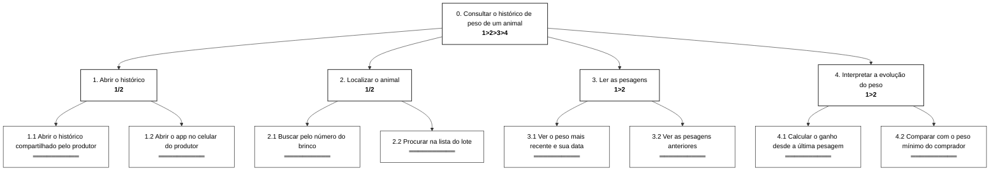
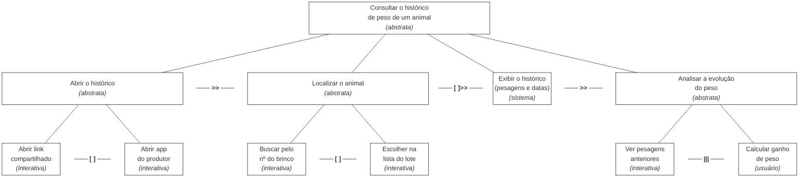

# Entrega 5 — Análise de tarefas: HTA, GOMS e CTT

**Data:** {{13/10/2026}}  
**Status:** 🟨 em andamento 
**Responsabilidade:** cada integrante modela pelo menos 1 HTA, 1 GOMS e 1 CTT. As três técnicas podem abordar a mesma funcionalidade ou funcionalidades distintas, conforme a orientação da disciplina.

## Objetivo da atividade

Modelar tarefas importantes sob perspectivas complementares: decomposição hierárquica (HTA), estrutura de metas/métodos/operações (GOMS) e relações temporais entre tarefas (CTT). O diagrama deve ser acompanhado de interpretação textual.

## Para projetos cujo TCC não previa interface

Modele **tarefas humanas relacionadas ao uso da contribuição técnica**, e não a implementação interna do algoritmo. Exemplos de boas tarefas para análise:

- investigar uma consulta de baixo desempenho;
- configurar uma análise e selecionar parâmetros;
- submeter um dataset e verificar sua validade;
- acompanhar uma execução demorada;
- comparar dois resultados/modelos;
- interpretar uma recomendação e decidir se a aceita;
- localizar uma execução anterior usando busca/filtros;
- gerar e compartilhar um relatório;
- administrar papéis/permissões quando isso for parte do trabalho real;
- revisar um alerta e registrar uma decisão.

Um CRUD pode gerar tarefas relevantes, mas “cadastrar usuário” só merece modelagem se tiver significado no domínio (papéis, validações, riscos, permissões, dependências).

## Seleção das tarefas

| ID | Tarefa | Persona/cenário de origem | Frequência/criticidade | Autor responsável |
|---|---|---|---|---|
| T01 | Consultar o histórico de peso de um animal | P02 / C02 | [H] várias vezes por visita técnica / criticidade alta | Gustavo |

> Priorize tarefas necessárias para que o usuário alcance objetivos centrais. Não desperdice a modelagem em ações triviais isoladas, como “clicar em login”, se o objetivo relevante é maior. Da mesma forma, não modele o funcionamento interno do algoritmo como se fosse uma tarefa humana.

---

## HTA — T01 Consultar o histórico de peso de um animal

**Autor(a):** Gustavo Atui — 24.123.072-1
### Descrição da tarefa

**Objetivo:** saber como o peso de um animal evoluiu, para orientar o produtor.
**Início:** o técnico quer avaliar um animal do lote durante a visita.
**Conclusão:** o técnico sabe o ganho de peso do animal e se ele já atingiu o peso de venda.
**Contexto:** visita técnica mensal à fazenda (cenário C02).

### Diagrama



### Decomposição e planos

| ID | Objetivo/operação | Plano/ordem | Problema ou decisão de design observada |
|---|---|---|---|
| 0 | Consultar o histórico de peso de um animal | 1>2>3>4 / repetir 2>3>4 para cada animal | Passar para o próximo animal sem voltar ao início. |
| 1 | Abrir o histórico | 1/2 — 1.1 se o produtor enviou o link / senão, 1.2 | O acesso depende do produtor (H05). |
| 2 | Localizar o animal | 1/2 — 2.1 se o brinco estiver legível / senão, 2.2 | No curral o brinco pode estar sujo ou danificado. |
| 2.1 | Buscar pelo número do brinco | — | Teclado numérico e campo de busca grande. |
| 3 | Ler as pesagens | 1>2 | — |
| 3.1 | Ver o peso mais recente e sua data | — | Data sempre ao lado do peso. |
| 4 | Interpretar a evolução do peso | 1>2 / a 4.2 só se estiver avaliando a venda | — |
| 4.1 | Calcular o ganho desde a última pesagem | — | O app deve mostrar o ganho de peso. |
| 4.2 | Comparar com o peso mínimo do comprador | — | Perto do peso mínimo, o erro de ~20 kg gera dúvida (H02): avisar quando o peso estiver na margem de erro. |

**Verificação do HTA:**

- O objetivo 0 representa uma meta do usuário? Entender a evolução do peso, e não "abrir uma tela".
- As subtarefas são necessárias e suficientes? 
- Os **planos** indicam ordem, alternativa, repetição ou condição?
- A decomposição parou em nível útil para projeto de interação?

- O objetivo 0 é uma meta do usuário: entender a evolução do peso, e não "abrir uma tela".
- As subtarefas cobrem do acesso aos dados até a interpretação.
- Os planos indicam ordem (1>2), alternativa (1/2 em 1 e 2), condição (4.2) e repetição (2>3>4 no plano 0).
- A decomposição para nas operações em que aparecem decisões de interação (buscar pelo brinco ou pela lista).

---

## GOMS — T01 Consultar o histórico de peso de um animal

**Autor(a):** Gustavo Atui — 24.123.072-1

### Goal

`GOAL 0: saber como o peso de um animal evoluiu`

### Métodos, operadores e regras de seleção

```
GOAL 0: saber como o peso de um animal evoluiu
  GOAL 1: abrir o histórico
    METHOD 1.A: abrir o histórico compartilhado pelo produtor
    (SEL. RULE: o produtor enviou o link antes da visita)
      OP. 1.A.1: abrir a conversa com o produtor no WhatsApp
      OP. 1.A.2: tocar no link do histórico
      OP. 1.A.3: verificar se é o lote certo
    METHOD 1.B: usar o app no celular do produtor
    (SEL. RULE: o produtor não enviou o link)
      OP. 1.B.1: pedir o celular ao produtor
      OP. 1.B.2: abrir o app
      OP. 1.B.3: tocar no lote
  GOAL 2: localizar o animal
    METHOD 2.A: buscar pelo número do brinco
    (SEL. RULE: o brinco está legível)
      OP. 2.A.1: ler o brinco do animal no curral
      OP. 2.A.2: tocar no campo de busca
      OP. 2.A.3: digitar o número do brinco
      OP. 2.A.4: tocar no animal encontrado
    METHOD 2.B: procurar na lista do lote
    (SEL. RULE: o brinco está sujo, danificado ou ausente)
      OP. 2.B.1: rolar a lista de animais
      OP. 2.B.2: reconhecer o animal pela foto
      OP. 2.B.3: tocar no animal
  GOAL 3: interpretar a evolução do peso
    OP. 3.1: ler o peso mais recente e sua data
    OP. 3.2: ler a pesagem anterior e sua data
    OP. 3.3: calcular mentalmente o ganho de peso
    OP. 3.4: comparar com o peso mínimo do comprador
```

> Não chame qualquer passo de “método”. Em GOMS, métodos são sequências alternativas capazes de atingir uma meta; regras de seleção explicam quando escolher entre eles.

---

## CTT — T01 Consultar o histórico de peso de um animal

**Autor(a):** Gustavo Atui — 24.123.072-1

### Descrição

O técnico abre o histórico e localiza o animal, o animal escolhido é passado ao sistema, que exibe as pesagens. Depois o técnico analisa a evolução, vendo as pesagens e calculando o ganho em qualquer ordem.

### Diagrama



### Legenda e relações temporais usadas

| Operador/relação | Significado no diagrama | Exemplo no modelo |
|---|---|---|
| `>>` ativação | A tarefa da direita só começa após a da esquerda terminar | Abrir o histórico >> Localizar o animal |
| `[ ]>>` ativação com passagem de informação | Além da ordem, a informação produzida passa para a próxima tarefa | Localizar o animal [ ]>> Exibir o histórico (o animal escolhido) |
| `[ ]` escolha | Uma vez iniciada uma tarefa, a outra é desabilitada | Buscar pelo nº do brinco [ ] Escolher na lista do lote |
| `\|\|\|` concorrência | As tarefas podem ocorrer em qualquer ordem ou ao mesmo tempo | Ver pesagens anteriores \|\|\| Calcular ganho de peso |
 
**Tipos de tarefa:** abstrata: Consultar o histórico, Abrir o histórico, Localizar o animal, Analisar a evolução; sistema: Exibir o histórico; interativa: abrir link/app, buscar, escolher na lista, ver pesagens; usuário: Calcular ganho de peso.
 
**Interpretação:** "Calcular ganho de peso" é a única tarefa do usuário, feita fora do sistema; é a mesma carga cognitiva vista no GOMS.
 
---

Identifique, quando aplicável, tarefas de usuário, sistema, interação e tarefas abstratas. Verifique se concorrência, escolha, habilitação, desabilitação e repetição estão representadas corretamente segundo a notação adotada em aula.

---

## Síntese da equipe

T01 — Gustavo

O principal problema que apareceu nas três técnicas é que o técnico precisa fazer de cabeça a conta do ganho de peso (HTA 4.1, GOMS OP. 3.3 e a tarefa de usuário no CTT). Por isso, o app deve mostrar o ganho pronto ao lado das pesagens.
Também apareceu que o brinco nem sempre está legível no curral, então o app precisa oferecer tanto a busca pelo brinco quanto a lista do lote. Como o técnico avalia vários animais seguidos, deve ser fácil passar de um animal para o outro. Ficam em aberto o acesso ao histórico, que depende do produtor (H05), e a dúvida gerada pelo erro de ~20 kg em animais perto do peso mínimo (H02).


Quais problemas de interação, oportunidades e requisitos apareceram a partir das modelagens? Quais tarefas irão para o protótipo e para o teste de usabilidade?

## Checklist

- [ ] Cada integrante produziu ao menos 1 HTA, 1 GOMS e 1 CTT.
- [ ] Cada artefato identifica autor e tarefa.
- [ ] Diagramas são legíveis e possuem fonte editável quando possível.
- [ ] HTA contém planos, não apenas árvore de tópicos.
- [ ] GOMS distingue Goals, Operators, Methods e Selection Rules.
- [ ] CTT usa operadores temporais e tipos de tarefa coerentes.
- [ ] Há texto explicando cada diagrama.
- [ ] Tarefas estão ligadas a cenários/personas na rastreabilidade.
- [ ] Em TCC técnico, as tarefas descrevem o que a pessoa faz com a contribuição/resultados, não passos internos do código.
- [ ] CRUDs, relatórios, filtros e atividades administrativas foram escolhidos por relevância ao objetivo do usuário.
