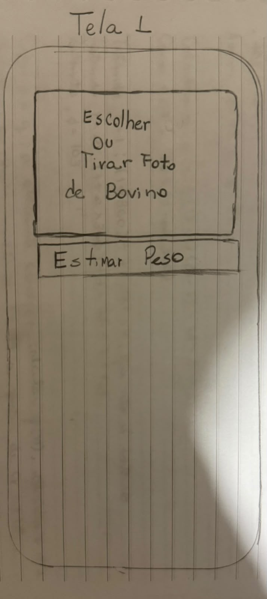
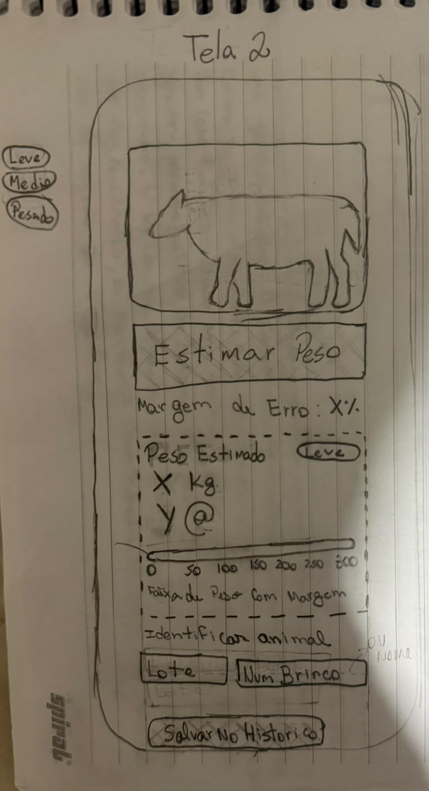
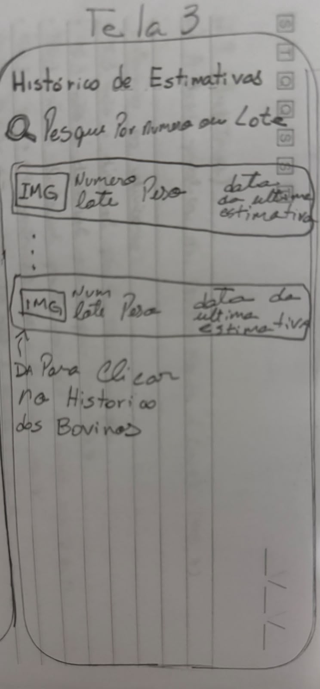
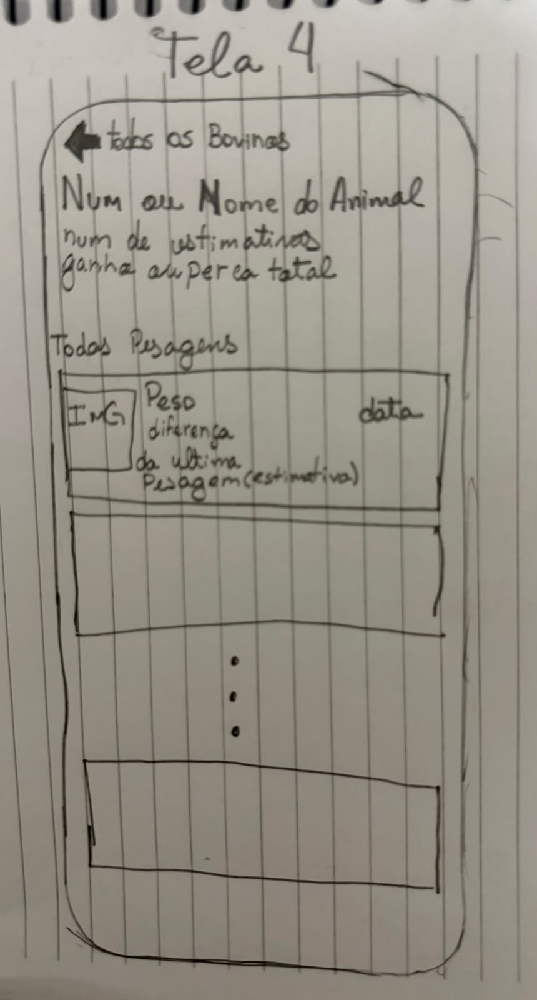
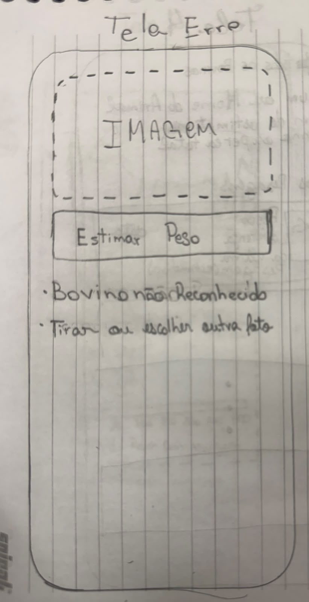

# Entrega 6 — Prototipação em papel

**Data:** 23/10/2026

**Status:** 🟨 em andamento

**Responsabilidade:** 1 solução integrada por equipe

## Objetivo da atividade

Externalizar rapidamente ideias de interação em baixa fidelidade para explorar alternativas antes de investir em detalhes visuais. O valor da atividade está no **ciclo construir → simular → observar → revisar**, não na beleza do desenho.

## 1. Escopo do protótipo

**Personas:** P01 Chico (pecuarista), P02 Dinho (técnico agropecuário) e P03 Agnaldo (peão)    
**Cenários/tarefas cobertos:** C03 (pesagem do lote com anotações perdidas) e C02 / T01 (consultar o histórico de peso de um animal)  
**Objetivos principais:** estimar o peso de um bovino por uma foto e salvá-lo no animal certo; acompanhar a evolução do peso de cada animal sem precisar fazer contas.

## 1.1 Possíveis famílias de interface

Escolha apenas o que for coerente com tarefas e cenários. Para TCCs técnicos, o protótipo pode explorar:

- **dashboard** para monitoramento e tomada de decisão;
- **configuração/parametrização** para preparar algoritmo/modelo/processo;
- **entrada/seleção de dados** com validação;
- **acompanhamento de execução** com progresso, fila, cancelamento e recuperação;
- **relatório/resultados** com explicação, gráficos e exportação;
- **histórico** com busca, filtros, ordenação e detalhes;
- **comparação** entre execuções, versões, algoritmos ou períodos;
- **administração** de usuários, papéis, permissões ou entidades do domínio;
- **auditoria/logs** traduzidos para o perfil;
- **alertas/ocorrências** com ação de resposta.

> Não desenhe todas essas telas por obrigação. O objetivo da baixa fidelidade é experimentar a **estrutura da interação** necessária para as tarefas priorizadas.

## 2. Fluxos escolhidos

| Fluxo | Tarefa/objetivo | Por que foi priorizado |
|---|---|---|
| PF01 | Estimar o peso de um bovino pela foto e salvar no animal (Chico e Agnaldo / C03) | É a contribuição central do TCC (peso sem balança) e liga cada peso ao animal certo. |
| PF02 | Consultar o histórico de peso de um animal (Dinho / C02 / T01) | Foi modelada na Entrega 5 (HTA, GOMS e CTT) e é a base da recomendação de venda. |
 

## 3. Telas e estados

- Numere as telas/estados (`P01`, `P02`...).
- Indique controles que mudam o estado.
- Mostre pelo menos caminhos principais e estados de erro/retorno relevantes.

| Tela | Conteúdo | Controle → próximo estado |
|---|---|---|
| Tela 1 — Estimar | Área "Escolher ou tirar foto do bovino" e botão "Estimar peso" | Escolher ou tirar a foto → Tela 2 |
| Tela 2 — Resultado | Foto do animal; peso estimado em kg e em @; selo da faixa (Leve, Médio, Pesado); margem de erro; barra com a faixa de peso; campos para identificar o animal (lote e brinco ou nome) | "Salvar no histórico" → Tela 3 · boi não reconhecido → E1 |
| Tela 3 — Histórico de estimativas | Busca por número ou lote; lista de bovinos com foto, número, lote, peso e data da última estimativa | Tocar num bovino → Tela 4 |
| Tela 4 — Histórico do animal | Número ou nome do animal, quantidade de estimativas, ganho ou perda total, lista de pesagens com foto, peso, data e diferença para a pesagem anterior | "← Todos os bovinos" → Tela 3 |
| E1 — Boi não reconhecido | "Não reconhecemos o boi. Fotografe de lado, com o corpo inteiro na foto." Não mostra peso nem o botão de salvar | "Tirar outra foto" → Tela 1 |

| Tela 1 — Estimar | Tela 2 — Resultado |
|---|---|
|  |  |
 
| Tela 3 — Histórico de estimativas | Tela 4 — Histórico do animal |
|---|---|
|  |  |

| Tela Erro — Bovino não identificado | . |
|---|---|
|  | . |
 
## 4. Simulação / walkthrough

Realize uma simulação com uma pessoa que não participou da elaboração dessas telas. Um colega pode ser usado **para essa iteração formativa**, mas isso não substitui os participantes finais da Entrega 14.

| Observação | Tela/ação | Evidência | Consequência para o design |
|---|---|---|---|
| {{...}} | {{...}} | {{...}} | {{...}} |

## 5. Alterações após a simulação

| Antes | Problema | Depois | Justificativa |
|---|---|---|---|
| {{...}} | {{...}} | {{...}} | {{...}} |

## Checklist

- [ ] O protótipo cobre tarefas relevantes da Entrega 5.
- [ ] Cada tela/estado pode ser justificado por uma tarefa, decisão ou informação necessária.
- [ ] O projeto não criou dashboard/CRUD/login apenas para parecer “completo”.
- [ ] Telas/estados estão numerados e navegáveis na documentação.
- [ ] Há pelo menos uma simulação/walkthrough documentado.
- [ ] Críticas não foram apenas listadas: geraram decisão de revisão.
- [ ] O protótipo continua em baixa fidelidade; detalhes visuais não mascaram problemas de fluxo.
