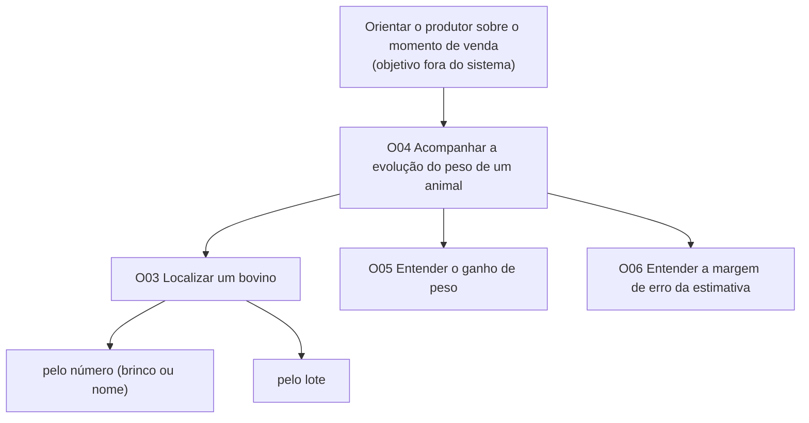

# Entrega 9 — Modelo conceitual e design centrado na comunicação

**Data:** 05/11/2026 
**Status:** 🟨 em andamento  
**Responsabilidade:** soluções individuais, com consolidação da equipe para mapa de objetivos e esquema de signos.

## Objetivo da atividade

Passar do cenário de problema para uma concepção da interação, explicitando objetivos, tópicos de conversa, falas e signos que a interface deverá comunicar/manipular.

## Transformando resultados técnicos em conceitos compreensíveis

Em TCCs algorítmicos ou orientados a dados, esta entrega deve evitar que a interface exponha apenas estruturas internas do código. Identifique os **conceitos e signos que fazem sentido para o usuário**.

Exemplos:

- `query plan`, custo estimado, recomendação e impacto para um DBA;
- modelo, dataset, versão, execução e métrica para engenheiro de IA;
- período, indicador, grupo, tendência e filtro para gestor/analista;
- alerta, severidade, evidência, responsável e status para analista de segurança.

Se um termo técnico for necessário, modele como será comunicado, explicado e relacionado à tarefa.

Dashboards, relatórios, filtros e CRUDs devem aparecer no modelo conceitual por meio dos **objetivos, signos e conversas** que justificam sua existência.

## 1. Cenários de interação

Para cada cenário de problema, produza uma versão em que a solução já pode ser descrita. **Destaque claramente o texto alterado** em relação ao cenário original.

### CI01 — {{título}}

**Autor(a):** {{nome — matrícula}}  
**Origem:** cenário problema {{C01}}

{{cenário de interação com alterações marcadas}}

## CI02 — Recomendação de venda com o histórico de peso
 
**Autor(a):** Gustavo Atui — 24.123.072-1  
**Origem:** cenário problema C02 (persona P02 — Dinho)
 
> Texto **em negrito e marcado com [ALTERADO]** mostra o que mudou em relação ao cenário de problema C02.
 
Dinho é técnico agropecuário e presta assistência a várias propriedades da região. Na visita mensal à fazenda do Chico, o produtor pergunta se o lote já está no ponto de venda, porque um comprador ofereceu um preço bom pela arroba.
 
**[ALTERADO: Desde a última visita, Chico e Agnaldo vêm fotografando os animais com o app, e cada estimativa ficou salva no animal, identificado pelo brinco ou por um nome.]** Dinho pede os registros de peso. **[ALTERADO: Em vez do caderno, Chico abre o app no celular e entrega a Dinho a lista de estimativas. Dinho digita o número do brinco do primeiro animal na busca e abre o histórico dele.]**
 
**[ALTERADO: Na tela, Dinho vê todas as pesagens do animal, com data, e quanto ele ganhou desde a anterior. O app mostra que o animal ganhou 17 kg desde a última pesagem, um mês antes, e avisa que cada peso pode variar um pouco para mais ou para menos.]** **[ALTERADO: Ele volta à lista e repete a consulta para os outros animais do lote. Quando o brinco está sujo, procura o animal pelo lote e o reconhece pela foto.]**
 
**[ALTERADO: Com os números em mãos, Dinho mostra a Chico que a maior parte do lote ainda está ganhando peso e que alguns animais estão perto do peso mínimo exigido pelo comprador, dentro da margem de erro.]** Dinho recomenda esperar mais algumas semanas **[ALTERADO: e pesar de novo antes de fechar a venda.]** **[ALTERADO: Desta vez, Chico vê os números junto com o técnico e decide esperar. Na pesagem seguinte, a maior parte do lote passa do peso mínimo, e Chico vende pelo preço combinado.]**
 
### Diferenças relevantes

| Alteração | Por que foi necessária | Evidência/artefato que justifica |
|---|---|---|
| Estimativas salvas no animal (brinco ou nome) | Sem saber de qual animal é cada peso, não há histórico | C03 (anotações perdidas); H09; Tela 2 da Entrega 6 |
| Busca pelo brinco e procura pelo lote | O brinco nem sempre está legível no curral | HTA 2.1/2.2 e GOMS GOAL 2 (Entrega 5); Tela 3 |
| Diferença entre pesagens já calculada | O técnico fazia a conta de cabeça | HTA 4.1, GOMS OP. 3.3 e CTT (Entrega 5); Tela 4 |
| Aviso de que o peso pode variar | A estimativa tem margem de erro e decide a venda | H02; Entrega 8 (princípio de comunicação da incerteza) |
| Recomendação com números vistos junto com o produtor | No C02 a recomendação sem números pesava tanto quanto a opinião do vizinho | C02 (Q2 e Q7, hipóteses) |
| Chico abre o app no próprio celular | O acesso do técnico aos dados ainda não foi resolvido | H05 (aberta) |

## 2. Design centrado na comunicação

**Nome do cenário:** {{CI01}}

| Tópico > subtópico | Falas e signos envolvidos | Intenção/efeito esperado |
|---|---|---|
| {{objetivo}} | `U: ...` / `D: ...` | {{...}} |
| > {{subtópico}} | {{...}} | {{...}} |

**Convenção:** `U` = usuário; `D` = preposto do designer/sistema, conforme a abordagem de Engenharia Semiótica adotada na disciplina.

**Nome do cenário:** CI02
 
| Tópico > subtópico | Falas e signos envolvidos | Intenção/efeito esperado |
|---|---|---|
| Acompanhar a evolução do peso de um animal | `U: Quero saber como este boi engordou.` / `D: Aqui estão os bovinos que você já pesou.` (lista de bovinos) | Mostrar que o histórico está organizado por animal |
| > Localizar o animal pelo número | `U: É o 042.` (digita na busca) / `D: Encontrei o 042, do lote Pasto 2. Última estimativa: 238 kg em 12/10.` | Achar o animal rápido, confirmando lote e última data |
| > Localizar o animal pelo lote | `U: Não consigo ler o brinco.` (busca pelo lote) / `D: Estes são os animais do lote Pasto 2, com a foto da última pesagem.` | Reconhecer o animal pela foto quando o brinco está ilegível |
| > Nenhum animal encontrado | `U: 157.` / `D: Não encontrei nenhum bovino com esse número. Confira o número ou procure pelo lote.` | Evitar beco sem saída e indicar outro caminho |
| > Ler as pesagens | `D: Este animal tem 3 estimativas. 12/10: 238 kg (7,9 @) · 10/09: 221 kg · 08/08: 206 kg.` | Mostrar a sequência com data, da mais recente para a mais antiga |
| > Entender o ganho de peso | `D: Ganhou 17 kg desde a estimativa anterior e 32 kg desde a primeira.` | Eliminar a conta de cabeça (achado da Entrega 5) |
| > Entender a margem de erro | `U: Esse peso é exato?` / `D: É uma estimativa: o peso real pode variar um pouco para mais ou para menos.` | Evitar que o peso seja tratado como pesagem de balança (H02) |
| > Consultar o próximo animal | `U: Agora o próximo.` / `D:` volta para a lista, mantendo a busca anterior | Avaliar vários animais seguidos sem recomeçar |
  
## 3. Mapa de objetivos

Cada integrante apresenta seu mapa e a equipe cria um **mapa consolidado**, eliminando duplicidades e resolvendo conflitos de nomenclatura.

### Mapa individual — Gustavo (CI02)

### Dicionário de objetivos

| ID | Objetivo | Persona(s) | Cenário(s) | Prioridade |
|---|---|---|---|---|
| O01 | {{...}} | {{P01}} | {{CI01}} | {{...}} |

## 4. Esquema conceitual de signos

Consolide as informações em **uma tabela única**.

| Grupo | Signo | Origem | Observações/semântica | Tipo de conteúdo | Restrição | Valor padrão | Prevenção | Recuperação |
|---|---|---|---|---|---|---|---|---|
| Credenciais | usuário | domínio | {{...}} | texto | não nulo | — | {{...}} | {{...}} |

### Regras para os signos

- Use o vocabulário do domínio do usuário.
- Evite duplicar o mesmo conceito com nomes diferentes.
- Diferencie informação fornecida pelo usuário, produzida pelo sistema e derivada do domínio.
- Registre prevenção e recuperação apenas quando fizer sentido; explique as siglas usadas.

## Síntese

**(CI02) - Gustavo:** os diagramas MoLIC precisam ter os objetivos O03 (localizar um bovino, pelo número ou pelo lote), O04 (acompanhar a evolução do peso), O05 (entender o ganho de peso) e O06 (entender a margem de erro). Os signos obrigatórios são identificação, lote, peso estimado (kg e @), margem de erro, data, diferença para a anterior e ganho total. Também precisam aparecer a fala de recuperação "nenhum bovino encontrado" e a volta à lista para consultar o próximo animal.

Quais objetivos/tópicos/signos deverão necessariamente aparecer nos diagramas MoLIC?

## Checklist

- [ ] Cenários de interação mostram alterações em relação aos cenários de problema.
- [ ] Cada solução individual identifica autor e cenário de origem.
- [ ] Tópicos/falas/signos são coerentes com objetivos do usuário.
- [ ] Mapas individuais foram consolidados.
- [ ] O esquema de signos está em uma tabela única e sem duplicações conceituais.
- [ ] Nomes de objetivos/signos serão reutilizados na Entrega 10.
- [ ] Em TCC técnico, signos representam conceitos do domínio compreensíveis ao usuário, não apenas variáveis/estruturas internas.
- [ ] Padrões como dashboard, relatório, filtros, administração e CRUD possuem objetivos e signos correspondentes.
- [ ] A interface comunica não só o resultado técnico, mas também seu significado para a tarefa.
