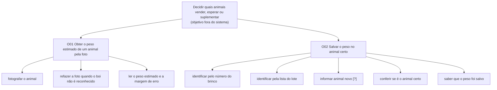
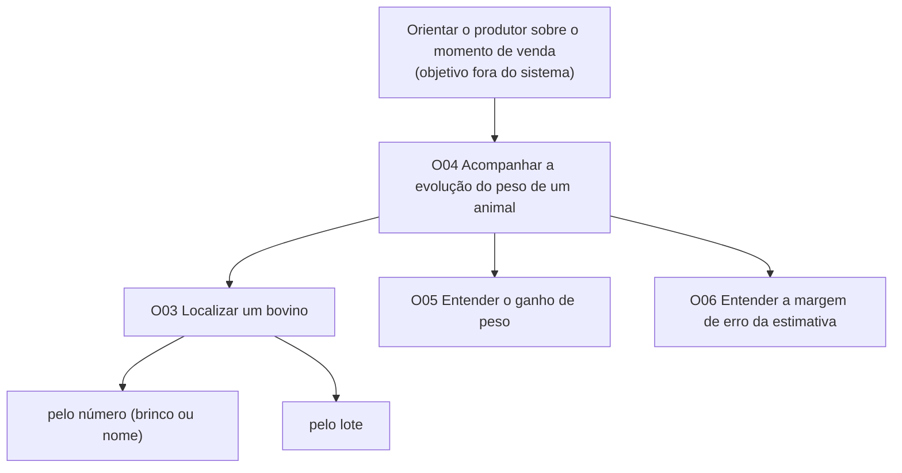

# Entrega 9 — Modelo conceitual e design centrado na comunicação

**Data:** 05/11/2026 
**Status:** 🟨 em andamento  
**Responsabilidade:** soluções individuais, com consolidação da equipe para mapa de objetivos e esquema de signos.

## Objetivo da atividade

Passar do cenário de problema para uma concepção da interação, explicitando objetivos, tópicos de conversa, falas e signos que a interface deverá comunicar/manipular.

## Transformando resultados técnicos em conceitos compreensíveis

Em TCCs algorítmicos ou orientados a dados, esta entrega deve evitar que a interface exponha apenas estruturas internas do código. Identifique os **conceitos e signos que fazem sentido para o usuário**.

Exemplos:

- `query plan`, custo estimado, recomendação e impacto para um DBA;
- modelo, dataset, versão, execução e métrica para engenheiro de IA;
- período, indicador, grupo, tendência e filtro para gestor/analista;
- alerta, severidade, evidência, responsável e status para analista de segurança.

Se um termo técnico for necessário, modele como será comunicado, explicado e relacionado à tarefa.

Dashboards, relatórios, filtros e CRUDs devem aparecer no modelo conceitual por meio dos **objetivos, signos e conversas** que justificam sua existência.

## 1. Cenários de interação

Para cada cenário de problema, produza uma versão em que a solução já pode ser descrita. **Destaque claramente o texto alterado** em relação ao cenário original.

### CI01 — Pesar o lote pelo celular e decidir entre vender, esperar ou suplementar

**Autor(a):** Rafael Takahagi Mendes — 22.126.084-7  
**Origem:** cenário problema C01 (persona P01 — Chico)

> Texto **em negrito e marcado com [ALTERADO]** mostra o que mudou em relação ao cenário de problema C01 (versão refinada na Entrega 4).

Chico cria cerca de 30 bovinos jovens no pasto da propriedade. Numa manhã de sábado, na época da seca, quando o pasto enfraquece e o suplemento pesa no custo, ele passa pelo pasto e olha o lote. Pensa em duas coisas ao mesmo tempo: se algum animal já está no ponto de vender e se vale comprar suplemento para segurar os mais magros até a chuva voltar. Para decidir, ele precisa saber quanto cada animal pesa hoje, quanto ganhou desde a última pesagem e se já passou do peso mínimo que o comprador exige. **[ALTERADO: Desde que começou a usar o app, Chico fotografa os animais do lote a cada poucas semanas, e cada estimativa fica salva no animal, identificado pelo brinco ou por um nome.]**

**[ALTERADO: Em vez de procurar o caderno, Chico abre o app no próprio celular. Sem balança e sem levar o lote até o vizinho, ele fotografa um animal de cada vez, de lado e com o corpo inteiro na tela, como o app orienta. Alguns segundos depois, o app mostra o peso estimado em kg e em @, junto de um aviso de que é uma estimativa e pode variar uns 20 kg para mais ou para menos.]**

**[ALTERADO: Para guardar o peso, Chico digita o número do brinco e o app mostra o animal com a foto da última pesagem. Quando o brinco está sujo ou caiu, ele procura o animal na lista do lote e o reconhece pela foto ou pelo nome que deu a ele, como "o pintado". Antes de salvar, o app mostra o brinco e a foto do animal escolhido bem grandes, e Chico confere com o animal que está na frente dele. Ele salva, o app confirma em qual animal o peso ficou e já volta para a câmera.]** **[ALTERADO: Num animal que se mexeu, a foto sai cortada. O app avisa que não reconheceu o boi, não mostra peso e pede outra foto, e Chico tira de novo.]**

Ele chama o Agnaldo, em quem mais confia, porque está com o lote todo dia, e pergunta o que ele acha de cada animal. A resposta do Agnaldo nem sempre bate com a impressão do Chico. **[ALTERADO: Agnaldo também ajuda a manter os animais parados para a foto. Quando a opinião dele não bate com a de Chico, os dois olham o peso e o histórico do animal no app, em vez de ficar cada um na sua impressão.]**

**[ALTERADO: Com o lote fotografado, Chico abre o histórico dos animais que já tinham pesagem anterior e vê quanto cada um ganhou (essa consulta é detalhada no CI02). Com o ganho de cada animal e o peso de hoje, ele separa os que estão perto do peso mínimo do comprador, dentro da margem de erro, e os mais magros. Compra suplemento só para os magros e deixa os outros para pesar de novo em algumas semanas, antes de combinar a venda.]**

### Diferenças relevantes

| Alteração | Por que foi necessária | Evidência/artefato que justifica |
|---|---|---|
| Foto de um animal de cada vez, sem levar o lote à balança | Pesar um animal sozinho não compensava, porque exigia levá-lo até a balança do vizinho | C01 (Q4); Entrega 1 (seção 4.5) |
| Orientação para fotografar de lado, com o corpo inteiro | Chico não sabe sozinho se a foto serve para o modelo | H04; HTA 1 e 1.3 e GOMS GOAL 1 (Entrega 5); Tela 1 |
| Peso em kg e em @, com aviso de estimativa e margem de erro | Chico fala em arroba, e o erro médio de ~20 kg pesa na decisão | H02; [F] MAE ~20,75 kg (TCC 1); MQ01 (Entrega 8); Tela 2 |
| Identificação por brinco, por lista do lote com foto ou por nome | No caderno havia brinco ilegível e animal anotado como "o pintado" | C01 (caderno); HTA 3 e GOMS GOAL 3 (Entrega 5); Tela 2 |
| Conferência do brinco e da foto antes de salvar | Peso no animal errado estraga o histórico daquele animal (A02) | HTA 4, GOMS GOAL 4 e CTT A4 (Entrega 5); MQ02 e MU02 (Entrega 8) |
| Voltar direto à câmera depois de salvar | Num lote de ~30 animais, cada passo extra se repete 30 vezes | HTA 0 (Entrega 5); C01 |
| Aviso "boi não reconhecido", sem peso e sem salvar | A foto vai falhar no curral, e não pode ser salva uma estimativa errada | MQ03 e MU04 (Entrega 8); Tela E1 |
| Peso e histórico do animal como base na conversa com Agnaldo | Sem número, a opinião de cada um não se desempata | C01 (Q3) |
| Histórico com ganho de peso consultado depois da pesagem | Chico não sabia quanto cada animal ganhou entre as pesagens | R01; H03; Tela 4 (Entrega 6) |

## CI02 — Recomendação de venda com o histórico de peso
 
**Autor(a):** Gustavo Atui — 24.123.072-1  
**Origem:** cenário problema C02 (persona P02 — Dinho)
 
> Texto **em negrito e marcado com [ALTERADO]** mostra o que mudou em relação ao cenário de problema C02.
 
Dinho é técnico agropecuário e presta assistência a várias propriedades da região. Na visita mensal à fazenda do Chico, o produtor pergunta se o lote já está no ponto de venda, porque um comprador ofereceu um preço bom pela arroba.
 
**[ALTERADO: Desde a última visita, Chico e Agnaldo vêm fotografando os animais com o app, e cada estimativa ficou salva no animal, identificado pelo brinco ou por um nome.]** Dinho pede os registros de peso. **[ALTERADO: Em vez do caderno, Chico abre o app no celular e entrega a Dinho a lista de estimativas. Dinho digita o número do brinco do primeiro animal na busca e abre o histórico dele.]**
 
**[ALTERADO: Na tela, Dinho vê todas as pesagens do animal, com data, e quanto ele ganhou desde a anterior. O app mostra que o animal ganhou 17 kg desde a última pesagem, um mês antes, e avisa que cada peso pode variar um pouco para mais ou para menos.]** **[ALTERADO: Ele volta à lista e repete a consulta para os outros animais do lote. Quando o brinco está sujo, procura o animal pelo lote e o reconhece pela foto.]**
 
**[ALTERADO: Com os números em mãos, Dinho mostra a Chico que a maior parte do lote ainda está ganhando peso e que alguns animais estão perto do peso mínimo exigido pelo comprador, dentro da margem de erro.]** Dinho recomenda esperar mais algumas semanas **[ALTERADO: e pesar de novo antes de fechar a venda.]** **[ALTERADO: Desta vez, Chico vê os números junto com o técnico e decide esperar. Na pesagem seguinte, a maior parte do lote passa do peso mínimo, e Chico vende pelo preço combinado.]**
 
### Diferenças relevantes

| Alteração | Por que foi necessária | Evidência/artefato que justifica |
|---|---|---|
| Estimativas salvas no animal (brinco ou nome) | Sem saber de qual animal é cada peso, não há histórico | C03 (anotações perdidas); H09; Tela 2 da Entrega 6 |
| Busca pelo brinco e procura pelo lote | O brinco nem sempre está legível no curral | HTA 2.1/2.2 e GOMS GOAL 2 (Entrega 5); Tela 3 |
| Diferença entre pesagens já calculada | O técnico fazia a conta de cabeça | HTA 4.1, GOMS OP. 3.3 e CTT (Entrega 5); Tela 4 |
| Aviso de que o peso pode variar | A estimativa tem margem de erro e decide a venda | H02; Entrega 8 (princípio de comunicação da incerteza) |
| Recomendação com números vistos junto com o produtor | No C02 a recomendação sem números pesava tanto quanto a opinião do vizinho | C02 (Q2 e Q7, hipóteses) |
| Chico abre o app no próprio celular | O acesso do técnico aos dados ainda não foi resolvido | H05 (aberta) |

## 2. Design centrado na comunicação

**Nome do cenário:** CI01

| Tópico > subtópico | Falas e signos envolvidos | Intenção/efeito esperado |
|---|---|---|
| Pesar um animal pelo celular e guardar o peso no animal dele | `U: Quero saber quanto este boi pesa.` / `D: Tire uma foto do boi de lado, com o corpo inteiro.` (tela de captura) | Orientar a foto antes de ela ser tirada (H04) |
| > Fotografar o animal | `U:` (tira ou escolhe a foto e toca em "Estimar peso") / `D: Calculando o peso...` | Mostrar que o app está trabalhando e evitar toque duplo |
| > Boi não reconhecido | `U:` (foto cortada) / `D: Não reconhecemos o boi. Fotografe de lado, com o corpo inteiro na foto.` (ícone e botão "Tirar outra foto") | Recuperar sem salvar estimativa errada (MQ03) |
| > Ler o peso estimado | `U: Quanto ele pesa?` / `D: Peso estimado: 214 kg (7,1 @). É uma estimativa: pode variar cerca de 20 kg para mais ou para menos.` | Chico lê o peso na unidade dele e entende que não é peso de balança (H02) |
| > Identificar pelo número do brinco | `U: É o 117.` (digita) / `D: Encontrei o 117, do lote Pasto 2.` (com a foto da última pesagem) | Achar o animal e confirmar que é ele pela foto |
| > Identificar quando o brinco está ilegível | `U: O brinco está sujo.` (abre o lote) / `D: Estes são os animais do lote Pasto 2, com a foto da última pesagem.` | Reconhecer o animal pela foto ou pelo nome, como "o pintado" |
| > Nenhum animal encontrado | `U: 157.` / `D: Não encontrei nenhum bovino com esse número. Confira o número, procure pelo lote ou informe como animal novo.` | Evitar beco sem saída. [?] O caminho do animal novo ainda não foi decidido (Entrega 5) |
| > Conferir antes de salvar | `D: Salvar 214 kg no boi 117, lote Pasto 2?` (brinco e foto grandes) / `U:` compara com o animal à frente e toca em salvar | Evitar peso no animal errado (A02) |
| > Corrigir o animal escolhido | `U: Não é esse.` / `D:` volta para a identificação, sem perder o peso estimado | Corrigir sem refazer a foto |
| > Saber que salvou | `D: Peso salvo no boi 117, lote Pasto 2, em 14/11.` | Confirmar em qual animal o peso ficou |
| > Pesar o próximo animal | `U: Agora o próximo.` / `D:` abre a câmera, pronta para o próximo | Repetir o fluxo ~30 vezes sem recomeçar |

> A consulta ao histórico e o ganho de peso são o CI02. O CI01 termina quando o peso está salvo no animal certo.

**Nome do cenário:** CI02
 
| Tópico > subtópico | Falas e signos envolvidos | Intenção/efeito esperado |
|---|---|---|
| Acompanhar a evolução do peso de um animal | `U: Quero saber como este boi engordou.` / `D: Aqui estão os bovinos que você já pesou.` (lista de bovinos) | Mostrar que o histórico está organizado por animal |
| > Localizar o animal pelo número | `U: É o 042.` (digita na busca) / `D: Encontrei o 042, do lote Pasto 2. Última estimativa: 238 kg em 12/10.` | Achar o animal rápido, confirmando lote e última data |
| > Localizar o animal pelo lote | `U: Não consigo ler o brinco.` (busca pelo lote) / `D: Estes são os animais do lote Pasto 2, com a foto da última pesagem.` | Reconhecer o animal pela foto quando o brinco está ilegível |
| > Nenhum animal encontrado | `U: 157.` / `D: Não encontrei nenhum bovino com esse número. Confira o número ou procure pelo lote.` | Evitar beco sem saída e indicar outro caminho |
| > Ler as pesagens | `D: Este animal tem 3 estimativas. 12/10: 238 kg (7,9 @) · 10/09: 221 kg · 08/08: 206 kg.` | Mostrar a sequência com data, da mais recente para a mais antiga |
| > Entender o ganho de peso | `D: Ganhou 17 kg desde a estimativa anterior e 32 kg desde a primeira.` | Eliminar a conta de cabeça (achado da Entrega 5) |
| > Entender a margem de erro | `U: Esse peso é exato?` / `D: É uma estimativa: o peso real pode variar um pouco para mais ou para menos.` | Evitar que o peso seja tratado como pesagem de balança (H02) |
| > Consultar o próximo animal | `U: Agora o próximo.` / `D:` volta para a lista, mantendo a busca anterior | Avaliar vários animais seguidos sem recomeçar |
  
## 3. Mapa de objetivos

Cada integrante apresenta seu mapa e a equipe cria um **mapa consolidado**, eliminando duplicidades e resolvendo conflitos de nomenclatura.

### Mapa individual — Rafael (CI01)

### Mapa individual — Gustavo (CI02)

### Dicionário de objetivos

| ID | Objetivo | Persona(s) | Cenário(s) | Prioridade |
|---|---|---|---|---|
| O01 | Obter o peso estimado de um animal pela foto (fotografar, refazer a foto se o boi não for reconhecido, ler o peso e a margem de erro) | P01 | CI01 | Alta: é a atividade mais frequente (A01) |
| O02 | Salvar o peso no animal certo (identificar, conferir e salvar) | P01 | CI01 | Alta: é a atividade mais crítica (A02) |
| O03 | Localizar um bovino, pelo número (brinco ou nome) ou pelo lote | P02, P01 | CI02 (e CI01, na identificação antes de salvar) | Alta: sem achar o animal não há consulta nem salvamento. [?] Na consolidação, "identificar pelo brinco/pela lista do lote" (O02a/O02b) pode virar o mesmo O03, para não ter dois nomes para a mesma ação |
| O04 | Acompanhar a evolução do peso de um animal (ver as pesagens com data) | P02 | CI02 | Alta: é a base da recomendação de venda (A03, T01) |
| O05 | Entender o ganho de peso (diferença para a anterior e ganho total, sem fazer contas) | P02, P01 | CI02, CI01 | Média: depende de O04, mas é o que o técnico usa para decidir |
| O06 | Entender a margem de erro da estimativa (o peso não é de balança) | P01, P03 | CI01 (na hora da pesagem; o histórico não repete o aviso) | Alta: tratar a estimativa como peso exato leva à decisão errada (H02) |

## 4. Esquema conceitual de signos

Consolide as informações em **uma tabela única**.

| Grupo | Signo | Origem | Observações/semântica | Tipo de conteúdo | Restrição | Valor padrão | Prevenção | Recuperação |
|---|---|---|---|---|---|---|---|---|
| Foto | foto do animal | usuário | Foto de lado, com o corpo inteiro do boi. É o que gera o peso estimado | imagem | animal inteiro e de lado | — | Orientação "fotografe de lado, com o corpo inteiro" antes de tirar (H04) | Aviso "boi não reconhecido" e botão "Tirar outra foto" |
| Peso | peso estimado (kg) | sistema | Peso que o app calcula pela foto. Sempre apresentado como estimativa, nunca como peso de balança. [F] Erro médio do TCC ~20,75 kg | número inteiro, em kg | maior que 0; só aparece se o boi foi reconhecido | — | Mostrar sempre junto da margem de erro (H02) | Refazer a foto |
| Peso | peso estimado (@) | domínio | Mesmo peso na unidade que o produtor usa. [?] Regra de conversão do peso vivo para @ a confirmar com a equipe | número com 1 casa decimal, em @ | derivado do peso em kg | — | Sempre ao lado do kg | — |
| Peso | margem de erro | sistema | Quanto o peso pode variar. [H] Mostrar como "pode variar cerca de 20 kg para mais ou para menos". [?] Falta decidir o valor exibido e se ele muda com o peso | texto curto com número em kg | sempre visível junto do peso | [H] cerca de 20 kg | Não depender só de cor (Entrega 8) | — |
| Peso | faixa do animal (Leve, Médio, Pesado) | sistema | Selo da Tela 2. [?] Não há critério dos cortes nos documentos e não sabemos se o produtor usa esses termos. Decidir se mantém | texto (3 valores) | um valor por estimativa | — | — | — |
| Identificação | identificação do animal (brinco ou nome) | usuário | Número do brinco. Se o animal não tem ou o brinco está ilegível, nome ou descrição, como "o pintado" | texto curto | não nulo; [H] único dentro do lote | — | Busca aceita parte do número, teclado numérico grande (HTA 3.1.2) e brinco e foto grandes antes de salvar (HTA 4) | Se não achar, procurar pelo lote ou informar animal novo [?] |
| Identificação | lote | usuário | Grupo onde o animal está (ex.: "Pasto 2"). Serve para filtrar a lista quando o brinco não ajuda | texto curto | não nulo | [H] lote da última pesagem | — | — |
| Identificação | foto da última pesagem | sistema | Foto guardada na pesagem anterior. Ajuda a reconhecer o animal quando o brinco está ilegível (HTA 3.2.2) | imagem | só existe para animal já pesado | — | — | Sem foto, reconhecer pelo nome ou descrição |
| Salvamento | data da pesagem | sistema | Dia em que a estimativa foi feita, guardado sozinho ao salvar | data (dd/mm) | não editável [H] | dia de hoje | — | — |
| Salvamento | situação do salvamento | sistema | Diz em qual animal o peso ficou ("salvo no boi 117"). [H] "Pendente de envio" quando faltar sinal, fica fora do protótipo (Entrega 8) | texto curto | — | — | Mostrar animal e peso na mensagem | [H] Guardar no celular e enviar quando houver sinal |
| Avisos | aviso "boi não reconhecido" | sistema | Tela E1: "Não reconhecemos o boi. Fotografe de lado, com o corpo inteiro na foto." | texto com ícone | sem peso e sem botão de salvar | — | — | Botão "Tirar outra foto" volta à Tela 1 |
| Animal | sexo (macho ou fêmea) | usuário | Entra no cálculo e deixa a estimativa mais perto do peso real. É escolhido junto com a foto, antes de estimar | 2 valores | obrigatório para estimar | — | O botão "Estimar peso" só é liberado depois de escolher | Trocar o sexo apaga o resultado anterior e pede nova estimativa |
| Busca | busca por número ou lote | usuário | O que o usuário digita para achar o animal na lista (O03) | texto curto | — | vazio | Aceita parte do número; lote escolhido numa lista, sem digitar [H] | Aviso "nenhum bovino encontrado" com os caminhos de saída |
| Histórico | número de estimativas | sistema | Quantas pesagens o animal tem ("3 estimativas") | número inteiro | ≥ 1 | — | — | — |
| Histórico | lista de pesagens | sistema | Cada estimativa do animal com data, foto e peso em kg (o @ fica só na hora da pesagem), da mais recente para a mais antiga | lista | só estimativas salvas naquele animal | — | — | — |
| Histórico | diferença para a anterior | sistema | Peso desta estimativa menos o da anterior, com sinal ("+17 kg"). [?] As duas estimativas têm erro, então uma diferença menor que a margem pode ser só variação da foto. Decidir como avisar isso | número inteiro com sinal, em kg | só a partir da 2ª estimativa | — | — | Com 1 estimativa: "o ganho aparece a partir da segunda pesagem" |
| Histórico | ganho total | sistema | Última estimativa menos a primeira ("ganhou 32 kg desde a primeira"). Mesma ressalva da diferença | número inteiro com sinal, em kg | só a partir da 2ª estimativa | — | — | Idem |
| Avisos | aviso "nenhum bovino encontrado" | sistema | "Não encontrei nenhum bovino com esse número. Confira o número ou procure pelo lote." Usado no CI01 e no CI02 | texto curto | — | — | — | Mantém o número digitado para corrigir; oferece a busca pelo lote |

> Origem: **usuário** = informado por quem usa o app; **sistema** = produzido pelo app; **domínio** = vem do vocabulário ou da regra da pecuária.

### Regras para os signos

- Use o vocabulário do domínio do usuário.
- Evite duplicar o mesmo conceito com nomes diferentes.
- Diferencie informação fornecida pelo usuário, produzida pelo sistema e derivada do domínio.
- Registre prevenção e recuperação apenas quando fizer sentido; explique as siglas usadas.

## Síntese

**(CI01) - Rafael:** os diagramas MoLIC precisam ter os objetivos O01 (obter o peso estimado pela foto, com a volta para refazer a foto quando o boi não é reconhecido) e O02 (salvar o peso no animal certo, com os caminhos por brinco, por lote e por animal novo [?], e a conferência antes de salvar). Os signos obrigatórios são foto do animal, peso estimado (kg e @), margem de erro, identificação (brinco ou nome), lote, foto da última pesagem, data e situação do salvamento. As falas de recuperação que precisam aparecer são "boi não reconhecido" e "nenhum bovino encontrado". O fluxo também precisa voltar à câmera depois de salvar, para pesar o próximo animal.

**(CI02) - Gustavo:** os diagramas MoLIC precisam ter os objetivos O03 (localizar um bovino, pelo número ou pelo lote), O04 (acompanhar a evolução do peso), O05 (entender o ganho de peso) e O06 (entender a margem de erro). Os signos obrigatórios são identificação, lote, peso estimado (kg e @), margem de erro, data, diferença para a anterior e ganho total. Também precisam aparecer a fala de recuperação "nenhum bovino encontrado" e a volta à lista para consultar o próximo animal.

Quais objetivos/tópicos/signos deverão necessariamente aparecer nos diagramas MoLIC?

## Checklist

- [ ] Cenários de interação mostram alterações em relação aos cenários de problema.
- [ ] Cada solução individual identifica autor e cenário de origem.
- [ ] Tópicos/falas/signos são coerentes com objetivos do usuário.
- [ ] Mapas individuais foram consolidados.
- [ ] O esquema de signos está em uma tabela única e sem duplicações conceituais.
- [ ] Nomes de objetivos/signos serão reutilizados na Entrega 10.
- [ ] Em TCC técnico, signos representam conceitos do domínio compreensíveis ao usuário, não apenas variáveis/estruturas internas.
- [ ] Padrões como dashboard, relatório, filtros, administração e CRUD possuem objetivos e signos correspondentes.
- [ ] A interface comunica não só o resultado técnico, mas também seu significado para a tarefa.
