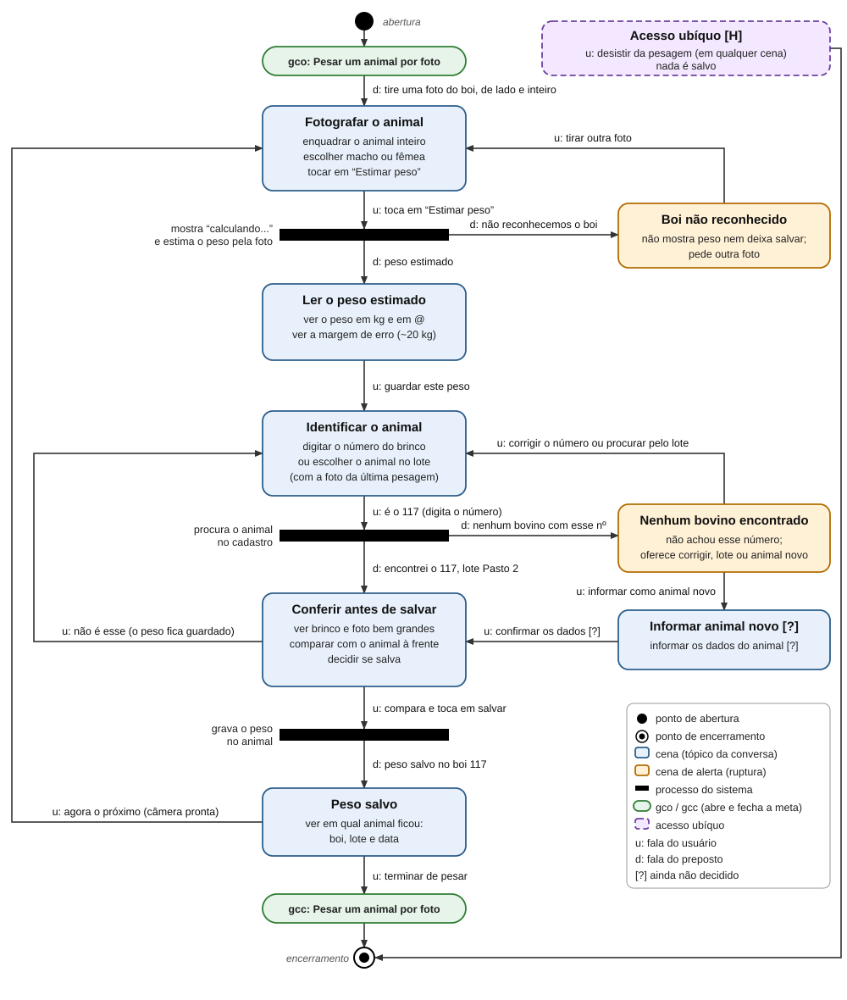

# Entrega 10 — MoLIC

**Data:** 12/11/2026  
**Status:** 🟨 em andamento  
**Responsabilidade:** 1 solução completa por integrante

## M01 — Pesar um animal por foto e salvar o peso no animal certo

**Autor(a):** Rafael Takahagi Mendes — 22.126.084-7  
**Cenário de interação de origem:** CI01  
**Objetivo(s):** O01 (obter o peso estimado de um animal pela foto) e O02 (salvar o peso no animal certo)  
**Tarefa(s) relacionada(s):** T02  
**Signos relevantes:** foto do animal, sexo, peso estimado (kg), peso estimado (@), margem de erro, identificação do animal (brinco ou nome), lote, foto da última pesagem, data da pesagem, situação do salvamento, aviso "boi não reconhecido", aviso "nenhum bovino encontrado"

### Diagrama

**Fonte editável:** o próprio arquivo `docs/assets/10_molic/molic_m01.svg` (texto editável em qualquer editor de código ou no draw.io).

### Leitura do diagrama

[F] A conversa segue a ordem do CI01 (Entrega 9) e da T02 (Entrega 5): fotografar, ver o peso, identificar o animal, conferir e salvar.

[F] A notação segue as aulas de MoLIC (partes A, B e C): cenas, diálogos, falas do usuário (`u:`) e do preposto (`d:`), acesso ubíquo, gco/gcc, processo do sistema e cena de alerta.

#### Caminho principal

1. A conversa abre no ponto de abertura, com `gco: Pesar um animal por foto`.
2. Cena **Fotografar o animal**: o preposto diz `d: tire uma foto do boi, de lado e inteiro`. O usuário enquadra o animal, escolhe macho ou fêmea e toca em "Estimar peso" (`u: toca em "Estimar peso"`).
3. Processo do sistema **estima o peso pela foto**. Enquanto trabalha, o app mostra "Calculando o peso...". Se reconheceu o boi, responde `d: peso estimado`.
4. Cena **Ler o peso estimado**: o usuário vê o peso em kg e em @ e a margem de erro (cerca de 20 kg para mais ou para menos). Depois diz `u: guardar este peso`.
5. Cena **Identificar o animal**: o usuário digita o número do brinco (`u: é o 117`) ou escolhe o animal no lote, reconhecendo pela foto da última pesagem.
6. Processo do sistema **procura o animal no cadastro**. Se acha, responde `d: encontrei o 117, lote Pasto 2`.
7. Cena **Conferir antes de salvar**: o app mostra brinco e foto bem grandes. O usuário compara com o animal que está à frente e toca em salvar (`u: compara e toca em salvar`).
8. Processo do sistema **grava o peso no animal** e responde `d: peso salvo no boi 117`.
9. Cena **Peso salvo**: o usuário vê boi, lote e data. Ele diz `u: agora o próximo` e a câmera abre pronta para o próximo animal (volta à cena Fotografar), ou `u: terminar de pesar`, que fecha a conversa (`gcc`) e leva ao ponto de encerramento.

[F] O peso aparece sempre como estimativa, com margem de erro, porque o erro médio (MAE) do modelo do TCC é de cerca de 20,75 kg (TCC 1) e mostrar só um número exato passa confiança demais (H02).

[H] A identificação vem depois do peso porque é assim que o Chico trabalha no CI01: ele fotografa o animal que está à frente e só depois diz de qual animal é. A conferência antes de salvar existe por causa do A02: peso no animal errado estraga o histórico daquele animal.

[H] O `u: terminar de pesar` fecha a conversa sobre pesar um animal. Fechar o lote inteiro é outra conversa, que é a T03 (Entrega 5) e não faz parte deste M01.

#### Alternativas e rupturas

| Situação | Onde ocorre | Como o usuário percebe | Caminho de recuperação/saída |
|---|---|---|---|
| Boi não reconhecido (foto cortada, animal se mexeu) | Processo "estima o peso pela foto" | Cena de alerta **Boi não reconhecido**: `d: não reconhecemos o boi. Fotografe de lado, com o corpo inteiro na foto.` Sem peso e sem botão de salvar (MQ03) | `u: tirar outra foto` volta para **Fotografar o animal** |
| Nenhum bovino encontrado | Processo "procura o animal no cadastro" | Cena de alerta **Nenhum bovino encontrado**: `d: não encontrei nenhum bovino com esse número. Confira o número, procure pelo lote ou informe como animal novo.` | `u: corrigir o número ou procurar pelo lote` volta para **Identificar o animal**; `u: informar como animal novo` vai para **Informar animal novo [?]** e, com `u: confirmar os dados [?]`, segue para a conferência |
| Brinco sujo, caído ou ilegível | Cena Identificar o animal | O usuário não consegue ler o número | Em vez de digitar, escolhe o animal na lista do lote, reconhecendo pela foto da última pesagem ou pelo nome (por exemplo, "o pintado"). Não passa por alerta |
| Animal escolhido não é o que está à frente | Cena Conferir antes de salvar | O brinco e a foto grandes não batem com o animal do curral (A02) | `u: não é esse` volta para **Identificar o animal**, sem perder o peso estimado e sem refazer a foto |
| Usuário desiste | Qualquer cena | Não há alerta, ele só quer parar | Acesso ubíquo `u: desistir da pesagem`, que leva ao encerramento. Nada é salvo |

[F] O contexto de uso (curral ou pasto, sol forte, poeira, mãos sujas, animal em movimento) vem da Entrega 3 e explica por que "boi não reconhecido" e "brinco ilegível" precisam de caminho de saída.

[H] O botão de desistir é hipótese. As telas das Entregas 6 e 11 vão confirmar como ele aparece.

[H] Escolher o sexo junto com a foto, antes de estimar, vem da Entrega 9 (signo "sexo"). Ele deixa a estimativa mais perto do peso real.

[?] O caminho do animal novo (como ele entra no app e quais dados são pedidos) continua em aberto desde a Entrega 5. Por isso a cena **Informar animal novo** está marcada com [?].

[?] A regra de conversão do peso vivo para @ ainda precisa ser confirmada com a equipe (Entrega 9).

[?] Falta de sinal e "pendente de envio" ficam fora deste MoLIC. A Entrega 9 deixou essa situação fora do protótipo (Entrega 8), então não foi modelada como cena. Se entrar numa versão futura, precisa de uma cena de alerta própria.

### Checklist específico de modelagem

- [] Existe **ponto de abertura** coerente com o início do objetivo.
- [] As **cenas de conversa** representam tópicos/assuntos, não nomes de páginas apenas.
- [] As transições/falas deixam claro o que o usuário ou o sistema comunica.
- [] Há **ponto(s) de encerramento** para objetivos concluídos/abandonados quando aplicável.
- [] Processamentos do sistema estão representados conforme a notação adotada em aula, sem "inventar" fala do usuário.
- [] Rupturas (breakdowns) relevantes têm feedback e caminho de recuperação, não becos sem saída.
- [] Acessos ubíquos/atalhos só aparecem quando semanticamente justificáveis (só "desistir da pesagem", marcado como [H]).
- [] O diagrama cobre caminhos alternativos importantes, e não apenas o "happy path".
- [] Nomes de objetivos, tópicos e signos são coerentes com a Entrega 9.
- [] O diagrama é legível em tamanho normal no GitHub.
- [] O MoLIC representa a conversa usuário–sistema, não o fluxo interno do algoritmo.
- [] Processamento, filtros, administração, relatórios e históricos incluem retornos/rupturas quando relevantes.

## Consolidação da equipe

### Cobertura dos objetivos

| Objetivo | MoLIC que cobre | Lacunas/duplicidades | Decisão |
|---|---|---|---|
| O01 | M01 | Nenhuma | Coberto no M01: fotografar, voltar quando o boi não é reconhecido, ler o peso e a margem de erro |
| O02 | M01 | [?] O caminho do animal novo continua em aberto | Coberto no M01: identificar, conferir e salvar, com a fala "nenhum bovino encontrado" |
| O03 | M01 (só a identificação antes de salvar) | [?] "Identificar pelo brinco ou pelo lote" (O02a e O02b) pode virar o mesmo O03, para não ter dois nomes para a mesma ação (Entrega 9) | Definir na consolidação da equipe |
| O06 | M01 (na hora da pesagem) | O histórico não repete o aviso de margem de erro (Entrega 9) | Coberto no M01 pela cena Ler o peso estimado |

### Preparação para o Figma

Estados/telas que saem da conversa do M01:

- **Fotografar o animal**: guia de enquadramento (de lado, corpo inteiro), escolha de macho ou fêmea e botão "Estimar peso" (Tela 1 da Entrega 9).
- **Calculando o peso**: estado de espera, para evitar toque duplo.
- **Boi não reconhecido**: aviso, sem peso e sem botão de salvar, com o botão "Tirar outra foto" (Tela E1).
- **Ler o peso estimado**: peso em kg e em @, margem de erro e botão para guardar o peso.
- **Identificar o animal**: campo de brinco com teclado numérico grande e lista do lote com a foto da última pesagem.
- **Nenhum bovino encontrado**: aviso com os caminhos de corrigir o número, procurar pelo lote ou informar como animal novo.
- **Informar animal novo [?]**: depende da decisão em aberto.
- **Conferir antes de salvar**: brinco e foto grandes, com "Salvar 214 kg no boi 117, lote Pasto 2?" e as opções de salvar ou "Não é esse".
- **Peso salvo**: confirmação com boi, lote e data, com os botões para o próximo animal e para terminar.
- **Desistir da pesagem [H]**: ação disponível em qualquer tela. A forma de mostrar fica para o Figma.
