# Entrega 13 — Avaliação de IHC por inspeção heurística

**Data:** 14/11/2026  
**Status:** 🟨 em andamento (avaliação do Rafael pronta; faltam as avaliações do Renan e do Gustavo e a consolidação)  
**Responsabilidade:** 1 avaliação completa por integrante, sobre todas as telas/estados relevantes do projeto.

## Objetivo da atividade

Encontrar problemas de usabilidade por inspeção sistemática da interface com as **10 heurísticas de Nielsen**. Cada avaliador trabalha individualmente primeiro; depois a equipe consolida problemas duplicados e prioridades.

> **Parte de violações:** registre somente problemas reais. Não invente uma violação para “preencher” cada heurística. Para provar que todas foram exercitadas, use a **matriz de cobertura H1–H10**. Para heurísticas sem violação, a disciplina solicita um exemplo didático de boa prática.

## 1. Heurísticas adotadas

1. Visibilidade do status do sistema
2. Compatibilidade entre o sistema e o mundo real
3. Controle e liberdade do usuário
4. Consistência e padrões
5. Prevenção de erros
6. Reconhecimento em vez de memorização
7. Flexibilidade e eficiência de uso
8. Estética e design minimalista
9. Ajudar usuários a reconhecer, diagnosticar e recuperar-se de erros
10. Ajuda e documentação

## Cobertura especial para interfaces administrativas e analíticas

No projeto não há dashboard, relatório, exportação, CRUD administrativo nem permissões (fora do escopo desde a Entrega 1). Os estados especiais que existem e foram inspecionados são: **processamento** (F01L), **erro e recuperação** (F02E, F02A, F02N), **confirmação** (F02C), **cancelamento** (F05D), **histórico e lista** (F03, F04, F02L), **estado vazio** (F03V), **busca** (F03) e **comunicação do resultado técnico** (peso estimado, margem de erro e ganho de peso em F02 e F04).

## 2. Escopo da inspeção

| Item | Definição |
|---|---|
| Versão avaliada | Protótipo do Figma da Entrega 11 (https://www.figma.com/proto/vvwn3MeDQGGoP3d3y5GCwB), versão de 14/11/2026, com as telas exportadas em `assets/11_figma/` (commit `53c1f17`) |
| Telas/estados | 19: F01, F01B, F01L, F01C, F02E, F02, F02A, F02P, F02L, F02U, F02N, F02X, F02C, F02S, F05, F05D, F03, F03V, F04 |
| Fluxos | M01 (O01 e O02): pesar um animal por foto e salvar no animal certo, com as rupturas "boi não reconhecido", "nenhum bovino encontrado", "brinco ilegível", "não é esse" e "desistir". Histórico (O03 a O05, telas F03, F03V e F04), ainda sem MoLIC |
| Dispositivo/viewport | Smartphone, frame de 360 × 800 px |
| Avaliadores | A01 Renan Casemiro Hessel, A02 Gustavo Atui, A03 Rafael Takahagi Mendes |

## 3. Procedimento individual

Cada avaliador deve:

1. percorrer os fluxos/telas ao menos uma vez para familiarização;
2. inspecionar novamente aplicando sistematicamente H1–H10;
3. registrar cada problema com evidência e contexto;
4. atribuir severidade **depois de compreender bem o problema**, justificando a decisão;
5. não discutir achados com os demais antes de terminar a inspeção individual, quando o objetivo for preservar independência.

### Escala de severidade (0–4)

| Grau | Interpretação |
|---:|---|
| 0 | não é considerado problema de usabilidade |
| 1 | problema cosmético; corrigir se houver tempo |
| 2 | problema menor; baixa prioridade |
| 3 | problema maior; alta prioridade |
| 4 | catástrofe de usabilidade; correção imperativa antes de disponibilizar |

Ao justificar, considere **frequência, impacto e persistência** do problema no contexto real de uso.

---

## Avaliador A03 — Rafael Takahagi Mendes (22.126.084-7)

**Como a inspeção foi feita:** primeiro percorri os 4 fluxos de partida do protótipo (principal, boi não reconhecido, nenhum bovino encontrado e histórico vazio). Depois passei tela por tela aplicando H1 a H10, pensando no contexto de uso da Entrega 3: curral ou pasto, sol forte, mãos sujas, animal em movimento e pressa (P01 Chico e P03 Agnaldo), e visita técnica (P02 Dinho).

**Limitação:** eu montei o M01 e o protótipo do Figma, então conheço o caminho certo de cada tarefa e posso deixar passar problemas que um avaliador de fora veria. Por isso a consolidação com A01 e A02 e o teste com usuários (Entrega 14) são importantes.

### 4. Matriz de cobertura das 10 heurísticas

| Heurística | Telas/fluxos examinados | Houve violação? | IDs dos achados | Exemplo de boa prática se não violada |
|---|---|---|---|---|
| H1 | Todas, com atenção a F01, F01L, F02S, F05, F05D, F03 | sim | V01, V02 | — |
| H2 | F01, F02, F02C, F02E, F04, F03 | sim | V03, V04 | — |
| H3 | F01B, F02, F02C, F02S, F04, F05D | sim | V05 | — |
| H4 | Todas (títulos, botões, nomes dos animais, cores) | sim | V08 | — |
| H5 | F01, F02, F02C, barra de navegação, Desistir | sim | V06, V07, V09 | — |
| H6 | F02L, F02C, F02N, F04, F01 | não | — | Lista do lote com a foto da última pesagem (F02L) e conferência com foto e brinco grandes (F02C) |
| H7 | F02S → F01 → F02 (pesar vários animais seguidos), F02L, F03 | sim | V10 | — |
| H8 | Todas, com atenção a F02, F01 e F02X | sim | V11, V12, V13 | — |
| H9 | F02E, F02A, F02N, F03 (busca) | sim | V14 | — |
| H10 | F01, F02E, F02C, F02L, F03V | não | — | Ajuda contextual no ponto onde a dúvida aparece (dica de foto em F01, instrução em F02E, F02C e F02L) |

### 5. Declaração de violações

| ID | Heurística | Tela/estado | Problema observado | Evidência | Severidade | Justificativa da severidade | Recomendação |
|---|---|---|---|---|---:|---|---|
| V01 | H1 | F01 | Ao abrir o app, "Estimar Peso" aparece cinza e desabilitado, mas nada diz por quê. Para liberar o botão é preciso escolher a foto **e** o sexo, e nenhum dos dois aparece como obrigatório. Quem já escolheu a foto e não percebeu o sexo fica com um botão que "não funciona" | 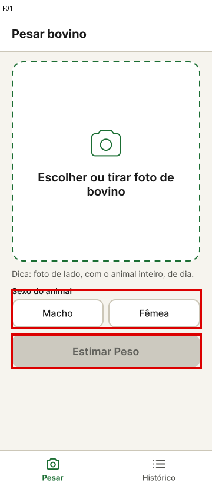 | 2 | Acontece no primeiro uso e sempre que o sexo é esquecido. O usuário acaba descobrindo, mas no curral, com o animal parado, a demora pesa. Não impede a tarefa | Mostrar abaixo do botão o que falta ("Escolha a foto e o sexo do animal") ou marcar "Sexo do animal" como obrigatório. Quando o botão for liberado, a mensagem some |
| V02 | H1 | F02S → F05 → F03 | O peso salvo no **Boi 117, lote Pasto 2, em 14/11/2026** não aparece no histórico. A lista da F03 só mostra outros animais (Brinco 1234, 1198… nos lotes 7, 3 e 1) com estimativas até 12/11. Quem salva e vai em "Ver histórico" não encontra o que acabou de salvar | 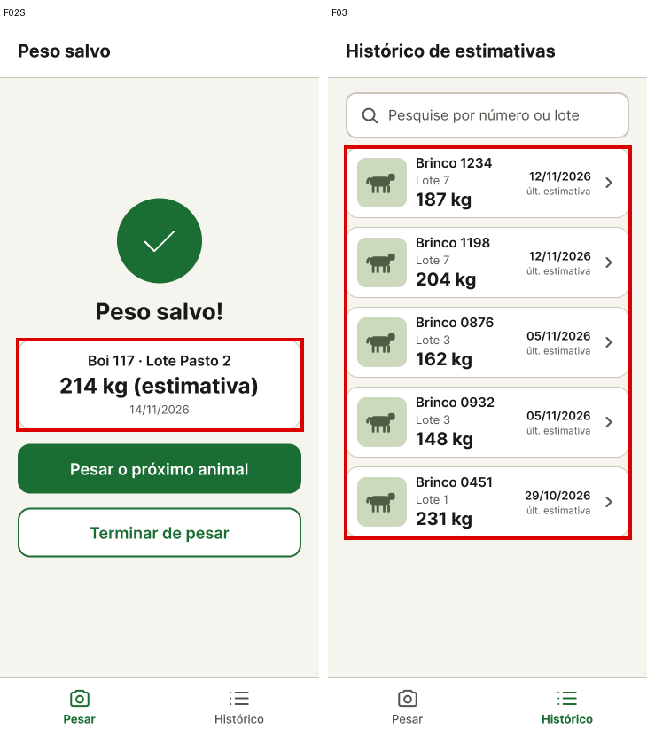 | 3 | É inconsistência dos dados do protótipo, mas no teste ela passa a mensagem de que o salvamento falhou e quebra a tarefa UT04 da Entrega 12 (consultar o histórico do boi 117). Acontece com todo participante | Colocar o Boi 117 (Pasto 2, 214 kg, 14/11/2026) no topo da F03 e criar o histórico dele na F04, com as mesmas pesagens anteriores usadas no resto do protótipo. **Corrigir antes da Entrega 14** |
| V03 | H2 | F04 (comparado com F02) | O histórico mostra cada diferença em verde como ganho ("+6 kg", "+8 kg", "+9 kg", "+11 kg"), mas todas são menores que a margem de erro de ± 20 kg mostrada na F02. Pela própria estimativa, o animal pode não ter engordado nada. O técnico (P02) usa essa diferença para recomendar a venda (CI02), e o histórico não lembra que os pesos são aproximados | 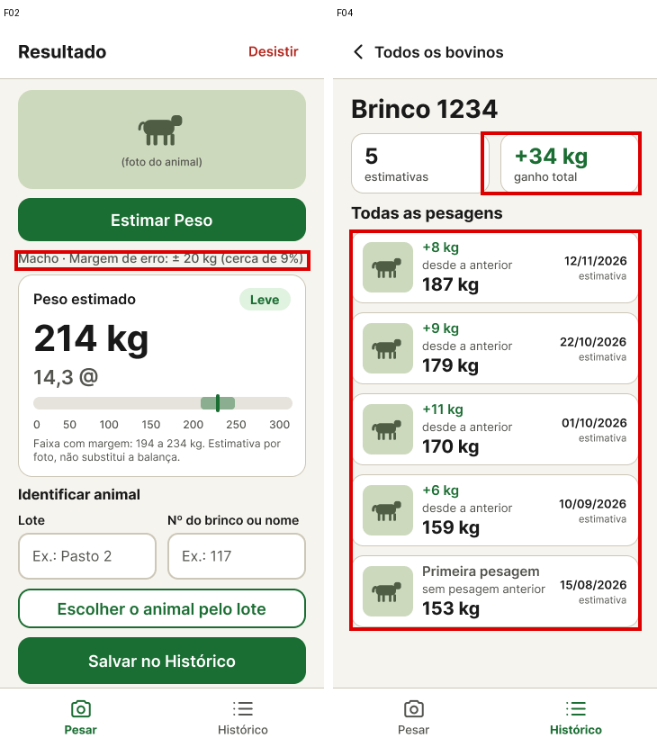 | 3 | Afeta a decisão de venda, que é o motivo de existir o histórico (H02, MQ01). Aparece em toda consulta e não é percebido pelo usuário, por isso persiste. Já estava como [?] no signo "diferença para a anterior" da Entrega 9 | Quando a diferença for menor que a margem, mostrar em cinza com "dentro da margem de erro" em vez de verde. No ganho total, acrescentar "pesos estimados, ± 20 kg cada". Decidir o texto com a equipe |
| V04 | H2 | F02 (também F02A, F02P, F02U) | A tag "Leve" aparece ao lado do peso, mas o app não diz o que é leve, médio ou pesado. O produtor pode entender "leve" como "não está no ponto de venda", o que não é a intenção. A Entrega 9 já marcava que não há critério para as faixas nem certeza de que o produtor usa esses termos | 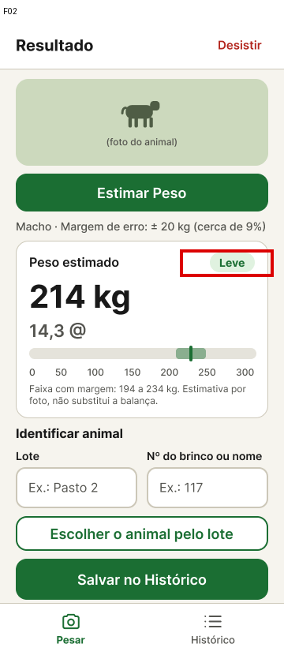 | 1 | Não impede nenhuma tarefa e o peso em kg e em @ está logo abaixo. O risco é de interpretação, baixo | Tirar a tag até a equipe definir o critério e confirmar o termo com usuários (Entrega 7). Se ficar, explicar a faixa ("Leve: até 250 kg") |
| V05 | H3 | F02S e F04 | Depois de salvar, não há como desfazer nem corrigir. A F02S só oferece "Pesar o próximo animal" e "Terminar de pesar", e a F04 não permite apagar ou mover uma pesagem. Um peso salvo no animal errado fica no histórico dele para sempre | 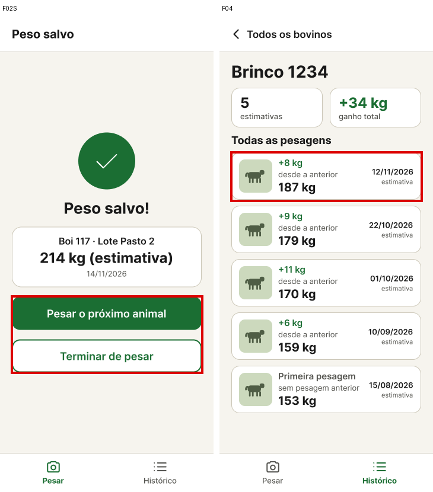 | 3 | A conferência da F02C reduz a frequência, mas o impacto é o pior do app: estraga o histórico daquele animal (A02, MU02) e o erro não tem saída. No curral, com 30 animais, um erro em algum momento é provável | Na F02S, um "Desfazer" por alguns segundos. Na F04, uma opção de "Remover esta pesagem" ou "Mover para outro animal", com confirmação |
| V06 | H5 | Botão "Desistir" (F01B a F02C) → F05D | "Desistir" fica no canto de cima, perto do título, e um toque leva direto para "Pesagem cancelada", descartando o peso estimado sem perguntar. Com a mão suja ou o celular balançando, o toque sem querer é possível, e o usuário precisa fotografar o animal de novo, que pode já ter saído do lugar | 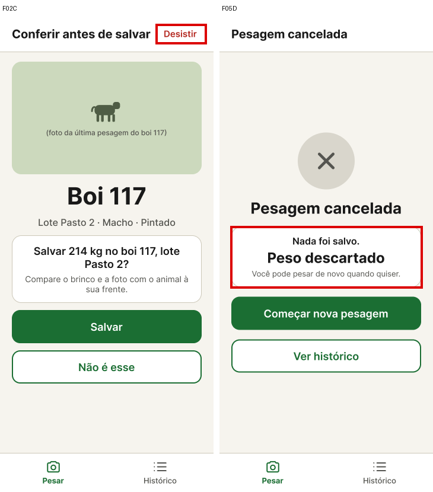 | 2 | Baixa frequência, mas o custo é refazer a foto com o animal solto. A tela F05D pelo menos deixa claro que nada foi salvo | Pedir confirmação quando já existe um peso estimado ("Descartar o peso de 214 kg?") ou oferecer "Desfazer" na F05D |
| V07 | H5 | Barra de navegação durante a pesagem (F02, F02P, F02L, F02N, F02C) | A aba "Histórico" fica disponível no meio da pesagem, com o peso ainda não salvo. Nada avisa que sair dali perde a estimativa | 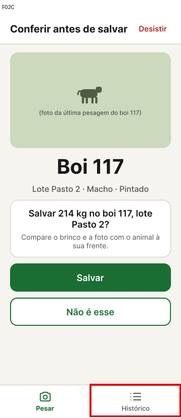 | 2 | É uma saída silenciosa com o mesmo efeito do "Desistir", mas sem nenhum aviso. Acontece pouco (o usuário raramente troca de aba no meio), mas o peso se perde | Esconder a barra durante a pesagem (de F01B até F02S), deixando só o "Desistir" como saída, ou avisar antes de sair que o peso não foi salvo |
| V08 | H4 | F01, F02C, F02E, F03, F04, F03V | O mesmo animal recebe nomes diferentes: "bovino" ("Pesar bovino", "foto de bovino", "Todos os bovinos", "Pesar primeiro bovino"), "boi" ("Boi 117", "Boi não reconhecido") e "Brinco 1234" (títulos da F03 e da F04). O lote também muda de padrão: "Pasto 2" na pesagem e "Lote 7" no histórico. Além disso, uma fêmea seria chamada de "Boi" na conferência | 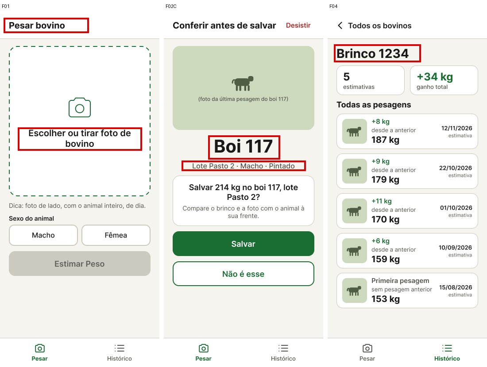 | 2 | Não impede tarefas, mas aparece em quase todas as telas e contradiz a decisão da Entrega 9 de usar "boi" como signo. O "Brinco 1234" no histórico e o "Boi 117" na pesagem fazem parecer que são cadastros diferentes | Escolher um termo para o animal (o signo da Entrega 9) e usar em todas as telas. No cartão e no título, usar o mesmo formato ("Boi 117" ou "117") na pesagem e no histórico. Para fêmea, usar "Vaca" ou só o número. Usar lotes com o mesmo padrão nos dados de exemplo |
| V09 | H5 | F02, campo "Lote" | O lote é digitado à mão em campo de texto livre. Um erro de digitação ("Pasto2", "pasto 2") cria na prática outro lote, e o animal some da lista do lote certo (F02L) e da busca por lote (F03) | 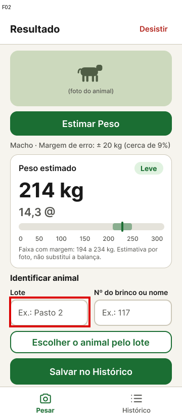 | 2 | Digitar com mão suja e teclado pequeno gera erro com frequência, e o problema só aparece depois, na consulta. Mas o brinco ainda permite achar o animal | Trocar o campo por uma lista dos lotes que já existem, com a opção "Novo lote" no fim |
| V10 | H7 | F02S → "Pesar o próximo animal" → F01 → F02 | Ao pesar vários animais seguidos (o caso do C03, cerca de 30 animais), o app esquece o sexo e o lote a cada animal. Em F01 nenhum sexo vem marcado e, em F02, o lote volta vazio ("Ex.: Pasto 2"), mesmo que todos sejam do mesmo lote. A Entrega 9 já previa o "lote da última pesagem" como valor padrão | 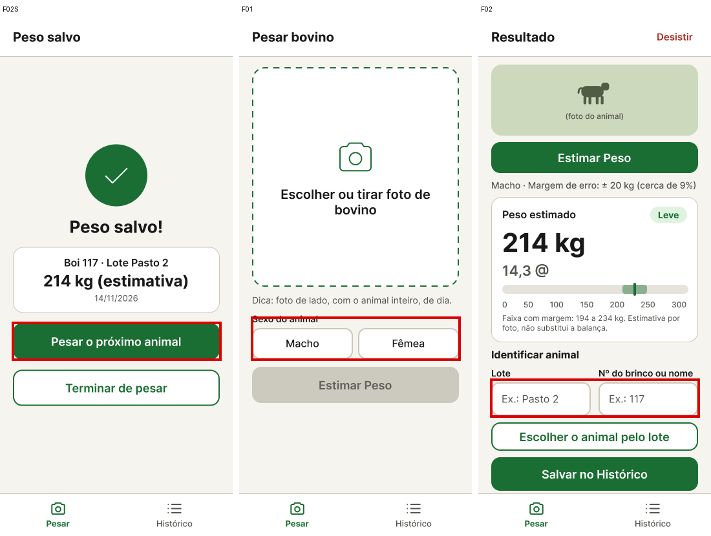 | 2 | Repete-se em todo animal do lote, então o custo soma. Não impede a tarefa, mas deixa a pesagem do lote mais lenta e cansativa (MU06) | Ao tocar em "Pesar o próximo animal", manter o lote preenchido e o último sexo marcado, com a possibilidade de trocar |
| V11 | H8 | F02 (também F02A, F02P, F02U) | Depois que o peso aparece, o botão "Estimar Peso" continua no topo, verde e com o mesmo destaque de "Salvar no Histórico". A tela fica com dois botões principais, e o que importa nesse momento (identificar e salvar) fica no fim da tela, colado à barra de navegação. Não fica claro o que acontece ao tocar em "Estimar Peso" de novo | 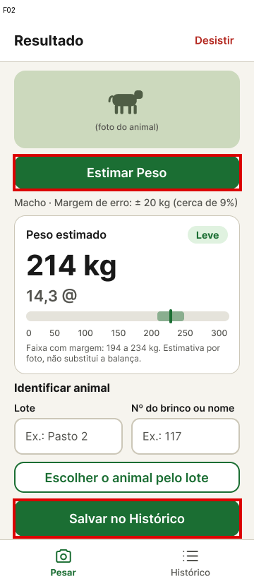 | 2 | Aparece em toda pesagem. Pode levar a estimar de novo sem querer ou a procurar o "Salvar" rolando a tela. Não impede a tarefa | Depois do resultado, tirar o "Estimar Peso" ou trocá-lo por um link discreto "Trocar foto". Deixar "Salvar no Histórico" como única ação principal |
| V12 | H8 | F01 e F02 | Os avisos mais importantes estão no menor texto da tela, em cinza: "Dica: foto de lado, com o animal inteiro, de dia" (F01) e "Faixa com margem: 194 a 234 kg. Estimativa por foto, não substitui a balança" (F02). Ao mesmo tempo, o peso ocupa 40 px. No sol forte do curral, esse texto pequeno e claro é o primeiro a sumir | 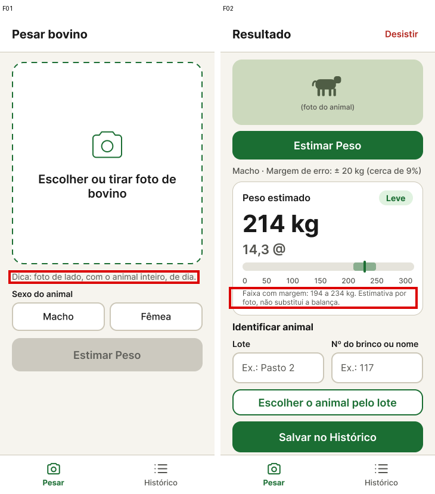 | 2 | A margem também aparece no topo em texto normal ("± 20 kg"), o que reduz o impacto em F02. Mas a dica de foto existe só ali, e foto ruim é a falha mais comum (F02E, MU04) | Subir a dica de foto para dentro da área da foto, com ícone e texto maior. Em F02, aumentar o tamanho e o contraste de "Estimativa por foto, não substitui a balança" |
| V13 | H8 | F02X | O texto "[?] Tela provisória: os dados pedidos para um animal novo ainda estão em definição pela equipe" aparece na própria tela, como se fosse parte do app. É uma anotação da equipe, não uma informação para o produtor | 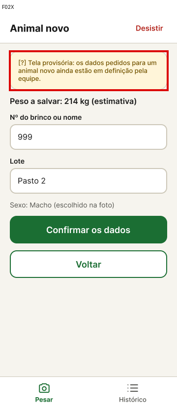 | 1 | Só aparece no caminho do animal novo, que não está nas tarefas do teste. Mas se um participante chegar lá (UT05), a nota confunde | Tirar a nota da tela e deixar a pendência registrada só na documentação (Entregas 10 e 11) |
| V14 | H9 | F03 (busca) | A busca "Pesquise por número ou lote" não tem estado para quando nada é encontrado. Se o técnico digita um brinco que não existe ou com erro, não se sabe o que a tela mostra: lista vazia sem explicação ou a lista inteira. Na pesagem esse caso foi tratado (F02N), no histórico não | 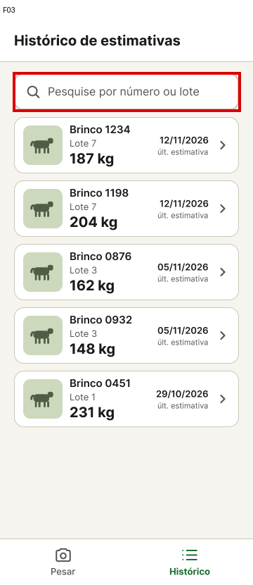 | 2 | Acontece sempre que o brinco é digitado errado ou o animal nunca foi pesado. Sem mensagem, a pessoa não sabe se errou o número ou se o animal não tem pesagem. Já estava registrado como "não prototipado" na Entrega 11 | Criar a tela F03R: "Nenhum bovino encontrado para '999'. Confira o número ou procure pelo lote", com "Limpar busca", no mesmo estilo da F02N |

### 6. Boas práticas — heurísticas não violadas (atividade didática)

| Heurística sem violação | Exemplo no sistema | Evidência | Por que atende |
|---|---|---|---|
| H6 | Lista do lote com a foto da última pesagem e o apelido do animal ("Pintado", "Malhado", "Mocho") em F02L, e conferência com foto e brinco grandes em F02C ("Compare o brinco e a foto com o animal à sua frente") |   | Quando o brinco está ilegível, o usuário reconhece o animal pela foto e pelo nome, em vez de lembrar o número. Na conferência ele compara com o animal à frente, em vez de confiar na memória do que digitou. A F02N também mostra o peso guardado, para ninguém precisar lembrar |
| H10 | Ajuda contextual onde a dúvida aparece: dica de foto em F01, instrução de como refotografar em F02E, instrução de comparar em F02C, "Toque no animal que está à sua frente" em F02L, e "Estime o peso de um bovino e salve para ver aqui" no histórico vazio (F03V) |   | O app é curto e não precisa de manual. Cada tela que pode gerar dúvida diz o que fazer em uma frase, no momento certo, que é o que P03 (que não lê instruções) precisa. A visibilidade da dica de foto é tratada em V12 (H8), não como falta de ajuda |

## Avaliador A02 — Gustavo Atui (24.123.072-1)

**Como a inspeção foi feita:** primeiro percorri os 4 fluxos de partida do protótipo (principal, boi não reconhecido, nenhum bovino encontrado e histórico vazio). Depois passei tela por tela aplicando H1 a H10, com atenção maior ao histórico (F03, F03V e F04), que é o objetivo do meu MoLIC (M02, CI02). Usei como contexto a visita técnica do P02 Dinho, que consulta o lote inteiro para recomendar a venda, e o curral do P01 Chico, com sol forte e mãos sujas.

**Limitação:** eu montei o M02, então conheço o caminho esperado no histórico e posso deixar passar problemas que um avaliador de fora veria. Também não montei as telas do Figma, então alguns detalhes de comportamento (o que a busca faz com um número que não existe, se a busca continua preenchida ao voltar) foram avaliados pelo que o protótipo mostra, sem saber o que estava planejado. Os prints são das telas exportadas em `assets/11_figma/`, com as marcações deste avaliador.

### 4. Matriz de cobertura das 10 heurísticas

| Heurística | Telas/fluxos examinados | Houve violação? | IDs dos achados | Exemplo de boa prática se não violada |
|---|---|---|---|---|
| H1 | Todas, com atenção a F01L, F02S, F05, F05D, F03 e F04 | não | — | "Calculando o peso…" com o botão "Estimando…" desabilitado (F01L) e selo de sucesso com boi, peso e data (F02S) |
| H2 | F04, F03, F02, F02C | sim | V02 | — |
| H3 | F04, F03, F02C, F05D | sim | V06 | — |
| H4 | Todas (nomes dos animais e dos lotes, títulos, botões) | sim | V07 | — |
| H5 | F02, F02C, F03 (busca), barra de navegação | não | — | Conferência antes de salvar, com brinco e foto grandes e "Não é esse" (F02C) |
| H6 | F03, F04, F02L, F02C | sim | V01 | — |
| H7 | F04 → pesagem, F02S → histórico, F05 → histórico | sim | V03, V04 | — |
| H8 | Todas, com atenção a F03, F04 e F03V | não | — | Resumo da F04 com só dois números (nº de estimativas e ganho total) antes da lista de pesagens |
| H9 | F03 (busca), F02E, F02N | sim | V05 | — |
| H10 | F03V, F02L, F02C, F02E | não | — | Histórico vazio (F03V) explica por que não há nada e oferece "Pesar primeiro bovino" |

### 5. Declaração de violações

| ID | Heurística | Tela/estado | Problema observado | Evidência | Severidade | Justificativa da severidade | Recomendação |
|---|---|---|---|---|---:|---|---|
| V01 | H6 | F03 | A lista mostra só o último peso e a data de cada animal. Para saber quem ganhou mais no lote, o técnico precisa abrir cada animal na F04, guardar o ganho de cabeça e voltar para o próximo. No CI02, o Dinho avalia o lote inteiro para recomendar a venda |  | 2 | Acontece em toda visita técnica e cresce com o tamanho do lote. Não impede a tarefa (UT04 consulta um animal só), mas deixa a comparação lenta e sujeita a erro de memória | Mostrar no card da F03 o ganho desde a pesagem anterior ou o ganho total, ao lado do último peso |
| V02 | H2 | F04 | O resumo mostra "Ganho total", mas não diz em quanto tempo. As 5 pesagens vão de 15/08 a 12/11/2026, e o usuário precisa olhar a primeira e a última data para saber o período. [H] Quem acompanha gado costuma falar em ganho por dia (kg/dia) ou por mês, e o app não mostra essa medida |  | 2 | O número aparece sozinho em toda consulta, e o técnico usa esse dado para decidir a venda. Um ganho total sem período não permite comparar animais pesados em datas diferentes | Escrever o período junto ("+X kg em 89 dias") e mostrar o ganho por dia. Confirmar com usuários qual medida eles usam (Entrega 14) |
| V03 | H7 | F04 | Na tela do animal não há como pesar esse mesmo animal. Para registrar uma nova pesagem, o usuário volta para "Pesar", tira a foto e digita de novo o lote e o brinco, que o app já conhece |  | 2 | Acontece sempre que o técnico consulta um animal e decide pesá-lo de novo. Repetir o brinco também abre espaço para digitar errado (A02) | Botão "Pesar este animal" na F04, que abre a pesagem com lote e brinco já preenchidos |
| V04 | H7 | F02S, F05 e F05D | Depois de salvar, "Ver histórico" (F05) leva para a lista geral (F03), e a F02S não tem ligação com o histórico do animal que acabou de ser pesado. Para conferir a pesagem, o usuário precisa buscar o brinco de novo |  | 1 | Não impede nenhuma tarefa e só incomoda quem quer conferir na hora. Mas é um passo a mais logo depois da pesagem | Na F02S, um link "Ver histórico do boi 117" que abre direto a F04 desse animal |
| V05 | H9 | F03 (busca) | A busca "Pesquise por número ou lote" não tem estado para quando nada é encontrado. O M02 define essa ruptura ("Não encontrei nenhum bovino com esse número. Confira o número ou procure pelo lote."), mas ela não foi prototipada. Na pesagem o mesmo caso tem a F02N |  | 2 | Acontece sempre que o brinco é digitado errado ou o animal nunca foi pesado. Sem mensagem, o técnico não sabe se errou o número ou se o animal não tem pesagem | Criar o estado "Nenhum bovino encontrado" na F03, com a busca ainda preenchida e as saídas "Corrigir o número" e "Procurar pelo lote", no mesmo estilo da F02N |
| V06 | H3 | F04, "Todos os bovinos" | A volta para a lista fica num link pequeno no canto de cima, com cerca de 28 px de altura, abaixo dos 48 px recomendados para toque. Com a mão suja ou com luva, é fácil errar o toque |  | 1 | A aba "Histórico" da barra de baixo também volta para a lista, então existe outra saída. O incômodo é repetido a cada animal consultado | Aumentar a área de toque do "Todos os bovinos" para pelo menos 48 px de altura |
| V07 | H4 | F03 e F04 (comparadas com F02L e F02C) | O histórico chama os animais de "Brinco 1234 · Lote 7", enquanto a pesagem usa "Boi 117" e lotes com nome ("Pasto 2"). Quem pesa o Boi 117 do Pasto 2 e depois abre o histórico vê outro formato de nome e de lote. Além disso, a F04 não mostra o lote do animal, que o M02 previa junto do número |  | 2 | Aparece em toda consulta. Não impede a tarefa, mas faz parecer que a pesagem e o histórico são cadastros diferentes, e contradiz o signo da Entrega 9 | Usar o mesmo formato nas duas partes ("Boi 117", "Lote Pasto 2") e dados de exemplo com o mesmo padrão |

### 6. Boas práticas — heurísticas não violadas (atividade didática)

| Heurística sem violação | Exemplo no sistema | Evidência | Por que atende |
|---|---|---|---|
| H1 | "Calculando o peso…" e "Pode levar alguns segundos." com o botão "Estimando…" desabilitado (F01L). Selo verde com boi, peso e data depois de salvar (F02S) | 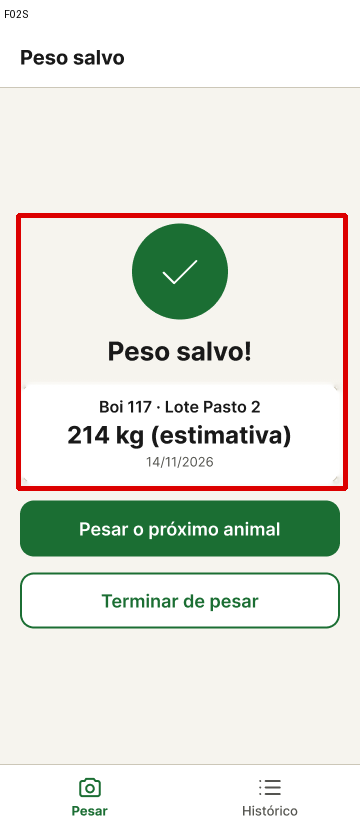 | O usuário sabe que o app está trabalhando e sabe quando o peso foi gravado, sem precisar adivinhar |
| H5 | Conferência antes de salvar (F02C), com o brinco em destaque, a foto da última pesagem e "Salvar 214 kg no boi 117, lote Pasto 2?" | 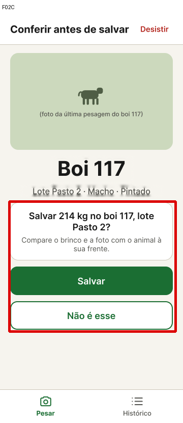 | Evita o erro mais caro do app, que é gravar o peso no animal errado, antes que ele aconteça |
| H8 | Resumo da F04 com só o nº de estimativas e o ganho total, e a lista de pesagens logo abaixo | 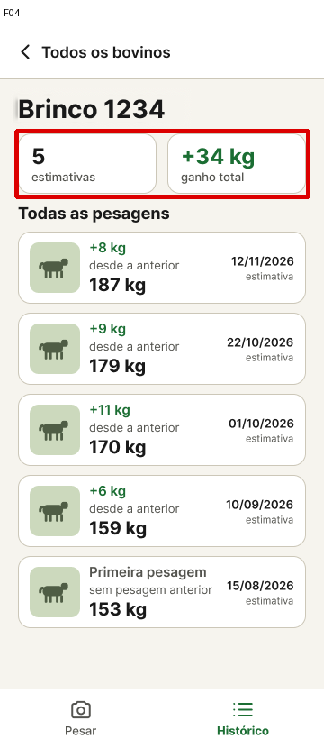 | O que o técnico procura aparece primeiro, sem informação extra competindo com o ganho |
| H10 | Histórico vazio (F03V): "Nenhuma pesagem salva ainda", explicação curta e o botão "Pesar primeiro bovino" |  | No primeiro uso, a tela diz por que está vazia e qual é o próximo passo, sem manual |

### Síntese do avaliador A02 (parcial até a consolidação)

- **Quantidade:** 7 violações em 6 das 10 heurísticas. Por severidade: 5 de severidade 2 (V01, V02, V03, V05, V07) e 2 de severidade 1 (V04, V06). Nenhuma de severidade 3 ou 4. Por heurística: H2 (1), H3 (1), H4 (1), H6 (1), H7 (2), H9 (1). H1, H5, H8 e H10 sem violação.
- **Foco:** a inspeção olhou com mais atenção o histórico (F03, F03V e F04), que é o objetivo do M02. Seis das sete violações estão nessas telas.
- **Padrões recorrentes:**
  - o histórico mostra os dados de um animal por vez, mas a tarefa do técnico é avaliar o lote inteiro (V01, V02);
  - a pesagem e o histórico funcionam como partes separadas: não se vai do animal para uma nova pesagem nem da pesagem salva para o histórico do animal (V03, V04), e os nomes mudam de uma parte para a outra (V07);
  - a ruptura da busca, definida no M02, não foi prototipada (V05).
- **Correções antes da avaliação com usuários (Entrega 14):** V07, junto com a V02 do Rafael, para que o Boi 117 apareça no histórico com o mesmo nome da pesagem e a UT04 funcione. V05 só se der tempo de criar o estado na F03. V01, V02 e V03 mudam o desenho do histórico e ficam para a consolidação.

> Repita a seção para A01 e A02, um avaliador por integrante.

## 7. Consolidação da equipe

Problemas iguais ou muito semelhantes encontrados por avaliadores diferentes devem ser consolidados, preservando quem os encontrou.

> **Pendente:** fazer depois das avaliações de A01 (Renan) e A02 (Gustavo).

| ID consolidado | Achados individuais | Heurística | Problema | Severidade final | Prioridade | Responsável pela correção |
|---|---|---|---|---:|---|---|
| HC01 | V02(A03), … | H1 | Peso salvo do Boi 117 não aparece no histórico | {{...}} | {{...}} | {{...}} |

## 8. Síntese e plano de melhoria

**Avaliador A03 (Rafael), parcial até a consolidação:**

- **Quantidade:** 14 violações em 8 das 10 heurísticas. Por severidade: 3 de severidade 3 (V02, V03, V05), 9 de severidade 2 e 2 de severidade 1 (V04, V13). Nenhuma de severidade 4. Por heurística: H1 (2), H2 (2), H3 (1), H4 (1), H5 (3), H7 (1), H8 (3), H9 (1). H6 e H10 sem violação.
- **Graves (severidade 3):**
  - V02, peso salvo que não aparece no histórico, **bloqueia o teste**: quebra a UT04 da Entrega 12 e faz o salvamento parecer falho. É a primeira correção.
  - V03, ganho dentro da margem mostrado como ganho real, e V05, peso no animal errado sem correção, atingem o que o projeto considera mais crítico: a margem de erro (H02, MQ01) e a identificação certa (A02, MU02).
- **Padrões recorrentes:**
  - a margem de erro é bem comunicada na pesagem e esquecida no histórico (V03, V12);
  - as saídas de um fluxo com peso não salvo não pedem confirmação (V06, V07) e, depois de salvar, não há volta (V05);
  - os dados de exemplo e os nomes não seguem um padrão entre a pesagem e o histórico (V02, V08).
- **Correções antes da avaliação com usuários (Entrega 14):** V02 (obrigatória), V11 e V13 (rápidas e influenciam as tarefas UT01 e UT05) e V01. V03, V05, V07, V08 e V14 devem ser discutidas na consolidação, porque mudam telas que o MoLIC do histórico (Gustavo) ainda vai definir.

**Avaliador A02 (Gustavo), parcial até a consolidação:**

- **Quantidade:** 7 violações em 6 das 10 heurísticas. Por severidade: 5 de severidade 2 (V01, V02, V03, V05, V07) e 2 de severidade 1 (V04, V06). Nenhuma de severidade 3 ou 4. Por heurística: H2 (1), H3 (1), H4 (1), H6 (1), H7 (2), H9 (1). H1, H5, H8 e H10 sem violação.
- **Foco:** a inspeção olhou com mais atenção o histórico (F03, F03V e F04), que é o objetivo do M02. Seis das sete violações estão nessas telas.
- **Padrões recorrentes:**
  - o histórico mostra os dados de um animal por vez, mas a tarefa do técnico é avaliar o lote inteiro (V01, V02);
  - a pesagem e o histórico funcionam como partes separadas: não se vai do animal para uma nova pesagem nem da pesagem salva para o histórico do animal (V03, V04), e os nomes mudam de uma parte para a outra (V07);
  - a ruptura da busca, definida no M02, não foi prototipada (V05).
- **Correções antes da avaliação com usuários (Entrega 14):** V07, junto com a V02 do Rafael, para que o Boi 117 apareça no histórico com o mesmo nome da pesagem e a UT04 funcione. V05 só se der tempo de criar o estado na F03. V01, V02 e V03 mudam o desenho do histórico e ficam para a consolidação.

## Checklist

- [ ] Cada integrante fez uma inspeção completa e identificada. *(A03 Rafael feito; faltam A01 e A02)*
- [x] Todas as telas/estados relevantes foram examinados.
- [x] Estados administrativos, filtros, relatórios, históricos, processamento e erros foram incluídos quando existentes.
- [x] A inspeção avaliou a interface/protótipo, não o mérito técnico do algoritmo/modelo.
- [ ] H1–H10 aparecem na matriz de cobertura de cada avaliador. *(feito para A03)*
- [x] Parte de violações contém apenas violações, sem “forçar” exemplos.
- [x] Todo problema tem print/localização e contexto.
- [x] Severidade possui justificativa, não apenas número.
- [x] Recomendação resolve a causa ou reduz o impacto.
- [ ] Achados duplicados foram consolidados ao final.
