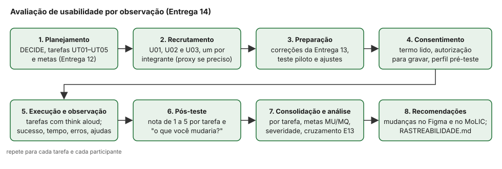

# Entrega 14 — Avaliação de usabilidade por observação de usuários

**Data:** {{16/11/2026}}  
**Status:** 🟨 em anadamento
**Responsabilidade:** solução consolidada por equipe. O número de participantes finais observados deve ser igual ao número de integrantes, conforme o modelo da disciplina; recomenda-se que cada integrante seja responsável por conduzir/analisar ao menos um participante.

## Objetivo da atividade

Observar usuários representativos realizando tarefas reais ou realisticamente simuladas para identificar problemas de eficácia, eficiência, compreensão e satisfação que não podem ser inferidos apenas por inspeção.

> **Participantes finais não devem ser membros da equipe.** Um integrante pode participar do teste piloto apenas para validar roteiro/equipamentos, sem contar na amostra final.

### Quando o usuário é um perfil profissional especializado

[F] O público do projeto é pecuarista ou quem decide a venda (P01 Chico), técnico agropecuário, zootecnista ou veterinário de campo (P02 Dinho) e peão ou funcionário que maneja o gado (P03 Agnaldo). Cada participante representa uma dessas personas. Se não for possível recrutar o perfil ideal, o participante proxy é um estudante de agronomia, zootecnia ou veterinária com experiência de manejo, como definido na Entrega 12. Ele é marcado como proxy em todas as tabelas e tratado como limitação: o resultado dele não é apresentado como equivalente ao de um pecuarista ou técnico.

[F] O teste avalia a **interação com o protótipo do Figma**, não o desempenho do modelo de estimativa. O peso mostrado (214 kg, ± 20 kg) é simulado e isso é dito ao participante antes de começar. O erro do modelo é avaliado no TCC.

## A. Fluxograma do processo — equipe

**Fonte editável:** [`fluxograma_avaliacao.svg`](../assets/14_testes/fluxograma_avaliacao.svg) (SVG em texto).

O processo segue: planejamento (Entrega 12) → recrutamento → preparação, com as correções da Entrega 13 e o teste piloto → consentimento → execução das tarefas com observação → pós-teste → consolidação e análise → recomendações.

## B. Procedimento de preparação e execução — equipe

### Passo 1 — Objetivos e versão avaliada

**Versão/commit/Figma:** protótipo da Entrega 11 (https://www.figma.com/proto/vvwn3MeDQGGoP3d3y5GCwB), 19 telas e 4 fluxos de partida. Versão de {{data da versão usada no piloto}}, {{commit}}. Registrar quais correções da Entrega 13 entraram antes das sessões.
**Metas de usabilidade relacionadas:** corrigir a V02 do Rafael (A03) na Entrega 13. O peso salvo do Boi 117 precisa aparecer no histórico (F03 e F04); sem isso a UT04 não funciona. [H] Junto com ela, a V07 do Gustavo (A02): o histórico deve usar o mesmo nome da pesagem ("Boi 117", "Lote Pasto 2").

**Metas de usabilidade relacionadas (Entrega 8):**

| Meta | O que mede | Tarefa |
|---|---|---|
| MU01 | Estimar e salvar no animal certo sem ajuda (≥ 80%) | UT01 |
| MU02 | Nenhum peso salvo no animal errado sem perceber | UT01, UT03 |
| MU03 | Encontrar o ganho de peso de um animal sem fazer contas (≥ 80%) | UT04 |
| MU04 | Refazer a foto sem ajuda depois de "boi não reconhecido" (≥ 80%) | UT02 |
| MU05 | Explicar que o peso é aproximado (≥ 80%) | Pergunta pós-UT01 |
| MU06 | Tempo de UT01 ≤ 60 s | UT01 |
| MU07 | Tempo de UT04 ≤ 30 s | UT04 |
| MU08 | Nota média ≥ 4 em "Foi fácil fazer isso?" | Todas |
| MQ01–MQ05 | Metas qualitativas (margem de erro, conferência, recuperação, vocabulário, uso com uma mão) | Observação e falas |

[F] Com 3 participantes, "≥ 80%" só é atingido com 3 de 3. Os resultados são apresentados como contagem ("2 de 3").

### Passo 2 — Participantes

| ID | Perfil | Critérios que justificam participação | Integrante responsável |
|---|---|---|---|
| U01 | {{pecuarista ou quem decide a venda (P01); sem nome real}} {{proxy: sim/não}} | Lida com gado de corte e usa smartphone. Não é da equipe e não viu o protótipo | Rafael |
| U02 | {{técnico agropecuário, zootecnista ou veterinário de campo (P02); sem nome real}} {{proxy: sim/não}} | Lida com gado de corte (orientação técnica) e usa smartphone. Não é da equipe e não viu o protótipo | Gustavo |
| U03 | {{peão ou funcionário que maneja o gado (P03); sem nome real}} {{proxy: sim/não}} | Lida com gado de corte (manejo) e usa smartphone. Não é da equipe e não viu o protótipo | Renan |

**Exclusão:** integrantes da equipe e quem já viu o protótipo, inclusive quem participou do piloto ou da simulação da Entrega 6.

### Passo 3 — Consentimento e privacidade

- Termo/registro de consentimento: [termo do teste](../instrumentos/termo_consentimento_teste.md), adaptado do [modelo da disciplina](../instrumentos/termo_consentimento_modelo.md) com o objetivo ("ver se o aplicativo é fácil de usar"), a duração (~25 min), o aviso de que o peso mostrado é simulado, a autorização separada para gravar e o direito de parar a qualquer momento.
- Gravação de tela/áudio/vídeo: sim, só com autorização separada no termo. Finalidade: conferir tempos, erros e falas na análise. [H] Sem gravar o rosto do participante.
- Forma de anonimização: IDs `U01`, `U02` e `U03`. Não coletamos nome da fazenda, endereço, número exato de cabeças nem fotos do participante (mesmos cuidados da Entrega 7).
- Local e período de armazenamento: pasta restrita aos 3 integrantes, apagada no fim da disciplina.

### Passo 4 — Teste piloto

**Data:** {{19/11/2026, confirmar}}, conduzido por Rafael com um colega de outra equipe. O piloto não entra na amostra.  
**O que foi validado:** duração (~25 min), se as instruções das tarefas são entendidas sem dar a resposta, se cada fluxo de partida abre na tela certa, se o link abre sem pedir permissão (janela anônima), a gravação e as duas dúvidas do protótipo (digitação do brinco e o que acontece ao escolher "Pintado" na F02L).  
**Mudanças após piloto:** {{...}}

### Passo 5 — Tarefas

| ID | Cenário/instrução apresentada | Critério de sucesso | Métricas | Ligação com modelo |
|---|---|---|---|---|
| UT01 | "Você está no curral. Na sua frente está um boi macho, o de brinco 117, que fica no Pasto 2. Você quer saber quanto ele pesa e deixar esse peso guardado no registro dele." *(fluxo 1, F01)* | Chega a "Peso salvo!" (F02S) com o boi 117 do Pasto 2, sem ajuda. Parcial: com uma ajuda ou depois de voltar mais de uma vez | sucesso, tempo, erros, ajudas, satisfação | T02 / O01 e O02 / M01 caminho principal / F01 → F01B → F01L → F02 → F02P → F02C → F02S. MU01, MU02, MU06 |
| — | Pergunta logo após a UT01: "Com o que você viu na tela, quanto esse boi pesa? Você usaria esse número do mesmo jeito que o da balança?" | Diz com as próprias palavras que o peso é aproximado ou que pode variar cerca de 20 kg | resposta anotada | O06 / MQ01. MU05 |
| UT02 | "Você tirou esta foto e quer saber o peso do animal." *(fluxo 2, F01C)* | Entende que a foto não serviu e volta para tirar outra, sem tentar salvar e sem ajuda | sucesso, tempo, erros, ajudas, satisfação | Ruptura "boi não reconhecido" / M01 / F02E → F01. MU04, MQ03 |
| UT03 | "O brinco deste boi está sujo e não dá para ler o número. Você sabe que ele é do Pasto 2 e que o pessoal chama ele de Pintado. Você quer guardar o peso que acabou de ver no registro dele." *(F02)* | Escolhe o Pintado na lista do lote, confere e salva, sem ajuda | sucesso, tempo, erros, ajudas, satisfação | T02, HTA 3.2 / O02 / M01 alternativa "brinco ilegível" / F02 → F02L → F02C → F02S. MU02 |
| UT04 | "O técnico que visita a fazenda quer saber quanto o boi 117 já engordou desde que começou a ser pesado." *(F01, aba de baixo disponível)* | Abre o histórico do boi 117 e diz o ganho total que aparece na F04 | sucesso, tempo, erros, ajudas, satisfação | T01 / O03, O04 e O05 / M02 caminho principal / F03 → F04. MU03, MU07, MQ04 |
| UT05 *(reserva)* | "Você quer guardar o peso deste boi, que você anotou como 999." *(fluxo 3, F02U)* | Entende que não há boi com esse número e escolhe uma saída sem ajuda | sucesso, tempo, erros, ajudas, satisfação | Ruptura "nenhum bovino encontrado" / M01 / F02U → F02N |

[H] A ordem é fixa (UT01 → UT02 → UT03 → UT04, UT05 se sobrar tempo), porque a UT01 apresenta o app. O efeito de aprendizagem entre as tarefas fica registrado como limitação.

### Passo 6 — Protocolo do moderador

1. Receber o participante e explicar que **o produto está sendo avaliado, não a pessoa**, e que o peso mostrado é simulado.
2. Ler o termo, obter o consentimento e a autorização separada para gravar.
3. Aplicar o questionário pré-teste (4 perguntas): papel no manejo do gado; com que frequência pesa ou acompanha o peso dos animais; se usa smartphone no dia a dia e para quê; se já usou algum app de pecuária.
4. Abrir o protótipo no celular, no fluxo de partida da tarefa, e ler a instrução padronizada do [roteiro](../instrumentos/roteiro_teste_usabilidade.md).
5. Observar sem ensinar o caminho. Não dizer "Salvar no histórico", "Escolher o animal pelo lote", "Tirar outra foto" nem a aba "Histórico". Pedidos de ajuda são anotados à parte na [planilha de observação](../instrumentos/planilha_observacao_modelo.md).
6. *Think aloud*: antes da UT01, pedir que o participante fale o que está pensando enquanto usa o app. [H] Se ele ficar calado por mais de 10 s, lembrar só uma vez por tarefa com "O que você está pensando agora?". O silêncio sozinho não é registrado como problema.
7. Depois de cada tarefa, perguntar "Foi fácil fazer isso?" (1 = muito difícil, 5 = muito fácil) e "O que deixou fácil ou difícil?". Depois da UT01, fazer também a pergunta sobre o peso (MU05).
8. No fim, perguntar "O que você mudaria nesse aplicativo?".
9. Encerrar, agradecer e explicar como os dados serão usados e quando serão apagados.

**Registro:** tempo do fim da leitura da instrução até a tela de sucesso (F02S na UT01, F04 na UT04). Na UT01 o participante começa na tela de captura (F01), como define a MU06. **Erro:** toque que sai do caminho da tarefa ou peso salvo no animal errado. **Dúvida:** hesitação de mais de 5 s ou pergunta em voz alta, sem pedir ajuda. **Ajuda:** qualquer dica do moderador. **Abandono:** o participante diz que desiste.

## C. Resultados — por participante

### U01 — {{perfil resumido}}

| Tarefa | Grau de sucesso | Erros | Tipos de erro/dificuldade | Ajudas | Tempo | Satisfação | Evidência/observação |
|---|---|---:|---|---:|---|---|---|
| UT01 | total/parcial/falha | {{n}} | {{...}} | {{n}} | {{mm:ss}} | {{escala}} | {{fala/comportamento}} |

**Link da gravação (se autorizado):** {{...}}  
**Resposta pós-teste:** {{...}}

> Repita para U02, U03...

## D. Consolidação por tarefa

| Tarefa | Taxa de sucesso | Tempo típico | Erros recorrentes | Satisfação | Meta atendida? | Problemas prioritários |
|---|---:|---|---|---|---|---|
| UT01 | {{...}} | {{...}} | {{...}} | {{...}} | sim/não | {{...}} |

## E. Achados e recomendações

| ID | Achado | Evidência (quant. + qual.) | Impacto | Recomendação | Artefatos a revisar |
|---|---|---|---|---|---|
| AU01 | {{...}} | {{2/4 falharam + fala U03...}} | {{...}} | {{...}} | {{MoLIC/Figma/signos...}} |

## F. Comparação com a avaliação heurística

| Problema | Detectado na heurística? | Detectado por usuários? | O que aprendemos |
|---|---|---|---|
| {{...}} | sim/não | sim/não | {{...}} |

## G. Conclusão

A conclusão deve responder:

1. Quais metas de usabilidade foram atingidas?
2. Quais problemas foram recorrentes e com quais perfis/tarefas?
3. O que surpreendeu a equipe?
4. Quais mudanças são prioritárias?
5. Que limitações do teste impedem generalizações amplas?

## Checklist

- [ ] Número de participantes finais atende ao enunciado.
- [ ] Participantes são representativos do público e não são membros da equipe.
- [ ] Se foram usados participantes proxy, a justificativa e a limitação estão explícitas.
- [ ] O teste avalia a interação; não confunde usabilidade do protótipo com desempenho técnico do TCC.
- [ ] Tarefas administrativas/analíticas usadas no teste são rastreáveis a objetivos e cenários.
- [ ] Há consentimento e anonimização.
- [ ] Foi realizado teste piloto.
- [ ] Tarefas têm critérios de sucesso definidos antes do teste.
- [ ] Moderadores não ensinaram o caminho durante a tarefa.
- [ ] Resultados estão separados por usuário e por tarefa.
- [ ] Foram registrados sucesso, erros, ajudas, tempo e satisfação quando aplicáveis.
- [ ] Conclusão combina evidência quantitativa e qualitativa.
- [ ] Achados geram recomendações e atualização da rastreabilidade.
